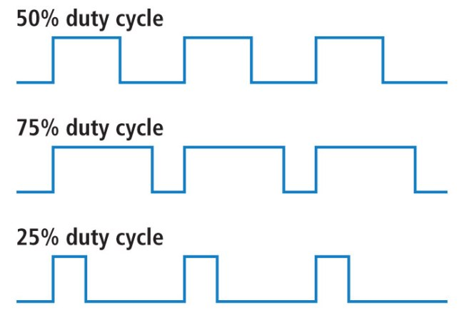

# Open-loop regeling van een aeropendulum

[Aangeleverde PDF openen](Aero_pendulum_OL.pdf)

## Leerdoelen

- Je kunt overweg met de Arduino IDE en begrijpt de werking van een H-brug, PWM en een hoeksensor.

- Je begrijpt de basis van I²C communicatie en weet de functie van SDA en SCL.

- Je kunt vanuit Python de Arduino aansturen, meetgegevens opslaan en deze vervolgens analyseren en visualiseren.

- Je kunt de dynamische respons van een simpel open-loop systeem experimenteel bepalen.

!!! veiligheid "Veiligheid"

    1. Houd tijdens de metingen voldoende afstand van de draaiende propeller en raak deze nooit aan wanneer de voeding is ingeschakeld.

    1. Controleer vóór iedere meting of het aeropendulum vrij kan bewegen en of zich geen objecten binnen het bewegingsbereik bevinden.

    1. De hoeksensor werkt op *3,3 V*. Sluit deze nooit rechtstreeks aan op de 5 V van de Arduino.

    1. Twijfel je over een handeling of apparaat? Vraag dit altijd aan de practicumbegeleider.

## Introductie

Regeltechniek speelt een belangrijke rol binnen de technische natuurkunde. Veel technische systemen, zoals drones, robots, satellieten, productieprocessen en autonome voertuigen, moeten automatisch bestuurd worden om een gewenste positie of toestand te bereiken. Voordat een regelsysteem ontworpen kan worden, is het belangrijk om eerst het gedrag van het systeem zelf goed te begrijpen. Dit gebeurt vaak door het systeem in open-loop te bestuderen.

Bij een open-loop systeem wordt een ingangssignaal aangeboden zonder dat de uitgang wordt teruggekoppeld naar de regeling. De besturing corrigeert dus niet voor verstoringen of afwijkingen. Hoewel deze manier van regelen relatief eenvoudig is, vormt zij de basis voor vrijwel alle moderne regelsystemen. Door de respons van een systeem op verschillende ingangssignalen te meten, kunnen eigenschappen zoals de gevoeligheid, tijdconstante, demping en niet-lineariteiten worden bepaald.

Een eenvoudig voorbeeld van open-loop regeling is een magnetron. Je stelt bijvoorbeeld een vermogen van 800 W en een tijd van 2 minuten in. De magnetron voert deze instelling uit, maar meet niet of het eten daadwerkelijk de gewenste temperatuur heeft bereikt.
Is het eten na 2 minuten nog te koud? Dan corrigeert de magnetron dit niet automatisch. De uitgang (temperatuur van het eten) wordt namelijk niet teruggekoppeld naar de ingang (vermogen en verwarmingstijd).

In dit practicum onderzoek je het dynamische gedrag van een aeropendulum. Dit systeem bestaat uit een arm die om een draaipunt kan roteren en wordt aangedreven door een elektrische propeller. De propeller levert een stuwkracht die de arm omhoog beweegt, terwijl de zwaartekracht de arm terug naar beneden probeert te brengen. Door de motorspanning stapsgewijs te variëren ontstaat een evenwicht tussen deze twee krachten, waardoor verschillende stationaire hoeken en dynamische responsen kunnen worden bestudeerd.

Tijdens het practicum meet je de hoek van het aeropendulum als functie van de tijd voor verschillende motorspanningen. De meetgegevens worden vervolgens in geanalyseerd om de dynamische eigenschappen van het systeem te bepalen en te vergelijken met een eenvoudig fysisch model. De kennis die in dit practicum wordt opgedaan vormt de basis voor een vervolgpracticum, waarin hetzelfde systeem met behulp van terugkoppeling (*closed-loop control*) automatisch zal worden geregeld.

## Theorie

Een aeropendulum bestaat uit een draaibare arm met aan het uiteinde een elektromotor en propeller. De propeller levert een stuwkracht waardoor de arm omhoog beweegt. De zwaartekracht werkt deze beweging tegen. Door het vermogen van de motor te variëren kan de positie van het aeropendulum worden beïnvloed.

In dit practicum wordt het systeem in open-loop onderzocht. Dit betekent dat het vermogen van de motor vooraf wordt ingesteld en niet automatisch wordt aangepast op basis van de gemeten hoek. Voor iedere instelling wordt vervolgens onderzocht hoe het aeropendulum reageert.

De propeller levert een stuwkracht $F_{T}$ op een afstand $l_{T}$ van het draaipunt. Het bijbehorende moment (soms ook uitgedrukt als $\tau$ voor *torque*) is

$$
M_{T} = l_{T} F_{T} . \tag{1}
$$

Tegelijkertijd oefent de zwaartekracht een moment uit op het systeem. Wanneer het zwaartepunt zich op een afstand $l$ van het draaipunt bevindt, is dit moment

$$
M_{g} = m g l \sin \theta \, \tag{2}
$$

waarbij $m$ de massa van het bewegende systeem is, $g$ de zwaartekrachtsversnelling en $\theta$ de hoek van de arm.

Volgens de tweede wet van Newton voor rotatie wordt de beweging bepaald door de som van deze momenten:

$$
J \alpha = J \ddot{\theta} = l_{T} F_{T} - m g l \sin \theta \, \tag{3}
$$

waarbij $J$ het massatraagheidsmoment van het aeropendulum en $\alpha \equiv \ddot{\theta}$ rond het draaipunt is.

<figure id="figuur-1" markdown="1">

{ width="55%" }

<figcaption markdown="1">Figuur 1. Schematische weergave van het aeropendulum en de relevante krachten.</figcaption>

</figure>

De stuwkracht van de propeller wordt bepaald door het vermogen dat aan de motor wordt geleverd. Het elektrisch ingangsvermogen is

$$
P_{\mathrm{el}} = U I \, \tag{4}
$$

met $U$ de spanning over de motor en $I$ de stroom door de motor. Slechts een deel van dit vermogen wordt door de motor en propeller omgezet in mechanisch vermogen. Met een rendement $\eta$ kan dit worden geschreven als

$$
P_{\mathrm{motor}} = \eta U I . \tag{5}
$$

De stuwkracht kan daarom worden beschouwd als een functie van het geleverde vermogen,

$$
F_{T} = f ( P_{\mathrm{motor}} ) . \tag{6}
$$

De precieze vorm van deze relatie hangt af van onder andere de motor en de propeller en hoeft niet lineair te zijn.

Wanneer het aeropendulum uiteindelijk tot stilstand komt, is de hoekversnelling nul. Het moment van de propeller is dan gelijk aan het moment van de zwaartekracht:

$$
l_{T} F_{T} = m g l \sin \theta . \tag{7}
$$

Hieruit volgt

$$
\theta = \arcsin (\frac{l_{T} F_{T}}{m g l}) . \tag{8}
$$

Een groter motorvermogen leidt in het algemeen tot een grotere stuwkracht en daarmee tot een grotere evenwichtshoek. Tijdens het practicum wordt deze relatie experimenteel onderzocht door het motorvermogen te variëren en de resulterende hoek van het aeropendulum te meten.

## Componenten

Het aeropendulum bestaat uit verschillende elektronische en mechanische componenten. De Arduino stuurt de motor aan via een H-brug en leest tegelijkertijd de hoek van het pendulum uit met een magnetische hoeksensor. De aansluittabel bij opdracht 0 geeft een overzicht van de gebruikte aansluitingen.

### Arduino Uno R4 Minima

Een Arduino is een programmeerbaar microcontroller waarmee elektronische componenten kunnen worden aangestuurd en sensoren kunnen worden uitgelezen. In dit practicum wordt een **Arduino Uno R4 Minima** gebruikt.

De Arduino voert continu een programma uit waarin twee taken centraal staan: het aansturen van de elektromotor en het meten van de hoek van het aeropendulum. Hiervoor beschikt de Arduino onder andere over digitale aansluitingen, analoge ingangen en verschillende communicatieprotocollen.

In deze opstelling worden de digitale pinnen D9, D10 en D11 gebruikt voor de aansturing van de motor. De AS5600-hoeksensor communiceert via de pinnen A4 en A5 met de Arduino.

### H-brug

Een elektromotor kan niet rechtstreeks vanuit een digitale uitgang van de Arduino worden gevoed. De motor vraagt aanzienlijk meer stroom dan een uitgang van de microcontroller kan leveren. De Arduino levert daarom alleen het *stuursignaal*; het elektrische vermogen voor de motor wordt geleverd door de externe voeding.

Tussen de Arduino en de motor bevindt zich daarom een **L298N H-brug**. Deze schakeling kan de externe voedingsspanning naar de motor schakelen. De naam H-brug komt van de configuratie van de interne schakelaars, die schematisch de vorm van de letter H heeft.

Door verschillende schakelaars te openen en sluiten kan de stroom door de motor in beide richtingen lopen. Daarmee kan ook de draairichting van de motor worden veranderd. Hiervoor gebruikt de L298N de ingangen IN1 en IN2. In onze opstelling worden deze aangestuurd door D10 en D11 van de Arduino.

### Pulse Width Modulation

Naast de draairichting willen we ook kunnen regelen hoeveel vermogen de motor ontvangt. Hiervoor wordt **Pulse Width Modulation (PWM)** gebruikt.

Bij PWM wordt de voedingsspanning niet continu veranderd. In plaats daarvan wordt de spanning snel aan- en uitgeschakeld. De verhouding tussen de tijd dat het signaal aan staat en de totale periodetijd noemen we de *duty cycle* $D$:

$$
D = t_{\mathrm{aan}} / T . \tag{9}
$$

Een duty cycle van $100 \%$ betekent dat de motor continu wordt aangestuurd. Bij $50 \%$ staat de spanning gedurende de helft van iedere periode aan en bij $0 \%$ staat de motor volledig uit.

Voor een ideale PWM-schakeling is de gemiddelde spanning over één periode

$$
U_{\mathrm{gem}} = D \, U_{\mathrm{voeding}} . \tag{10}
$$

De motor reageert door zijn mechanische en elektrische traagheid niet afzonderlijk op iedere snelle puls. Daardoor kan met de duty cycle het gedrag van de motor worden geregeld.

In onze opstelling genereert pin D9 van de Arduino het PWM-signaal. Dit signaal wordt aangesloten op de ENA-ingang van de L298N. De Arduino bepaalt dus wanneer de H-brug de motor inschakelt, terwijl het daadwerkelijke motorvermogen uit de externe voeding komt.

<figure id="fig-pwm" markdown="1">

{ width="50%" }

<figcaption markdown="1">Figuur 2. Voorbeeld van PWM-signalen met verschillende duty cycles. De amplitude blijft gelijk, maar de verhouding tussen de aan- en uittijd verandert.</figcaption>

</figure>

### AS5600-hoeksensor

De hoek van het aeropendulum wordt gemeten met een **AS5600 magnetische hoeksensor**. Op de draaiende as van het aeropendulum wordt een magneet geplaatst. De sensor meet de richting van het magnetische veld en kan daaruit de hoek van de as bepalen. Omdat er geen mechanisch contact nodig is tussen de sensor en de draaiende as, treedt hierbij vrijwel geen extra mechanische weerstand op.

De AS5600 heeft een resolutie van 12 bit. Eén volledige omwenteling wordt daardoor verdeeld in

$$
2^{12} = 4096 \tag{11}
$$

mogelijke waarden. Een ruwe sensorwaarde kan worden omgerekend naar een hoek volgens

$$
\theta = \text{sensorwaarde} / 4096 \, 360^{\circ} . \tag{12}
$$

De sensor wordt digitaal uitgelezen via het **I²C-protocol**, zie [Appendix C](#app-i2c) voor uitleg over deze communicatieprotocol. Hiervoor zijn twee verbindingen nodig: SDA (*Serial Data*) voor het versturen van gegevens en SCL (*Serial Clock*) voor het kloksignaal. In deze opstelling is SDA aangesloten op A4 en SCL op A5 van de Arduino.
Het volledige schakelschema is te vinden in [Appendix B](#app-schema).

De positie van de magneet ten opzichte van de sensor is belangrijk. Wanneer de magneet te ver van de sensor staat of niet goed boven het midden van de sensor is geplaatst, kan de hoekmeting onbetrouwbaar worden. Controleer daarom voor iedere meting of de sensor correct functioneert. Wanneer de arm langzaam met de hand wordt bewogen, moet de gemeten hoek vloeiend veranderen. Een constante waarde, grote sprongen of een foutmelding kan betekenen dat de magneet niet correct ten opzichte van de sensor staat.

!!! voorbereiding "Voorbereiding"

    1. Installeer de Arduino IDE en de Python-omgeving op je laptop. Controleer of de Arduino Uno R4 Minima wordt herkend en dat de juiste poort kan worden geselecteerd [Link naar Arduino IDE](https://www.arduino.cc/en/software/).

    1. Installeer de bibliotheek `AS5600` in de Arduino IDE. Controleer of de bibliotheek correct is geïnstalleerd door een voorbeeldsketch te openen en te uploaden naar de Arduino.

    1. Kloon of download de GitHub-repository van de practicumhandleiding. Controleer of de bestanden correct zijn gedownload en dat je toegang hebt tot de arduino- en pythonbestanden in de map. [Link naar github repository](https://github.com/HvA-TN/Practica/tree/main/leerjaar_2/practicum2_2)

    1. Bekijk de geometrie van het aeropendulum. Onder welke voorwaarde geldt $l = l_{T}$? Leg in woorden uit wat deze aanname fysisch betekent.

    1. In de stationaire toestand staat de arm stil en zijn de momenten rond het draaipunt in evenwicht. Laat zien dat dan geldt:

        $$
        l_{T} F_{T} = m g l \sin \theta . \tag{13}
        $$

    1. De motor zet niet al het opgenomen elektrische vermogen om in mechanisch vermogen. Neem een rendement van $\eta = 0.70$ aan:

        $$
        P_{\mathrm{mech}} = \eta U I . \tag{14}
        $$

        Bereken bij een voedingsspanning van $U = 5$ V het mechanisch vermogen voor een aantal verschillende motorstromen.

    1. Neem aan dat de stuwkracht van de propeller evenredig is met het mechanisch vermogen:

        $$
        F_{T} = C P_{\mathrm{mech}} \, \tag{15}
        $$

        waarbij $C$ een constante is die de eigenschappen van de motor en propeller beschrijft. Combineer de bovenstaande vergelijkingen en leid een uitdrukking af voor de stationaire hoek $\theta$ als functie van de motorstroom $I$.

    1. Kies realistische waarden voor $m$, $l$, $l_{T}$ en $C$. Licht kort toe waarom je deze waarden hebt gekozen. Maak vervolgens in Desmos een grafiek van $\theta$ als functie van $I$.

    1. Voorspel op basis van je grafiek wat er gebeurt wanneer de motorstroom wordt verhoogd. Verwacht je dat het eenvoudige model voor alle motorstromen even goed werkt? Leg kort uit.

## Experiment

Werk de opdrachten in onderstaande volgorde uit. Open iedere sketch vanuit zijn eigen gelijknamige map onder `Arduino/OpenLoop`. Selecteer in de Arduino IDE de Arduino Uno R4 Minima en de juiste poort. Installeer de bibliotheek `AS5600` van Rob Tillaart. Alle drie de scripts gebruiken 115200 baud.

!!! opdracht "Opdracht 0: opbouw van de opstelling en aansluitschema"

    1. Zet de Arduino Uno R4 Minima, AS5600-hoeksensor, L298N H-brug, motor en externe voeding klaar. Bekijk hoe de arm en de magneet bij het draaipunt zijn gemonteerd. Controleer of de arm vrij kan bewegen.

    1. Bouw de opstelling op met uitgeschakelde externe voeding en losgekoppelde USB-kabel. Sluit de hoeksensor aan volgens tabel [1](#tab-aansluitingen). Controleer per draad de Arduino-pin, draadkleur en aansluiting op de component. De H-brug gaan we in de volgende opdracht aansluiten.

    1. Laat de aansluiting van motor en de externe voeding op de H-brug aansluiting controleren door de practicumbegeleider. Spreek de voedingsspanning en stroomlimiet af en noteer deze in je labjournaal.

    1. Laat de complete opstelling controleren voordat je USB aansluit. Houd de motorvoeding uitgeschakeld: in opdracht 1 test je eerst alleen de hoeksensor met `Stap_1_Sensor.ino`.

**Tabel 1.** Aansluitingen van de Arduino naar de AS5600-hoeksensor.

| *Van Arduino* | *Draadkleur* | *Naar component* | *Aansluiting* |
| --- | --- | --- | --- |
| GND (Analog) | Zwart | Hoeksensor | GND |
| 3.3 V | Rood | Hoeksensor | VCC |
| A4 | Groen | Hoeksensor | SDA |
| A5 | Wit | Hoeksensor | SCL |

!!! opdracht "Opdracht 1: hoeksensor uittesten met stap 1"

    1. Gebruik de in opdracht 0 opgebouwde en gecontroleerde opstelling. Laat de motorvoeding uitgeschakeld en sluit alleen USB aan op de Arduino. Open `Arduino/OpenLoop/Stap_1_Sensor/Stap_1_Sensor.ino`: deze sketch leest uitsluitend de hoeksensor uit en stuurt de motor niet aan. Controleer in de code of je de juiste poorten uitleest.

    1. Upload het script en open Serial Monitor of Serial Plotter op 115200 baud. Het script geeft iedere 100 ms een regel zoals `Hoek:90.000` weer.

    1. Bekijk de omzetting `sensor.readAngle() * 360.0 / 4096.0` in de code. Leg uit waarom door 4096 wordt gedeeld en bepaal hoeveel graden een sensorstap voorstelt.

    1. Beweeg de arm langzaam met de hand. Controleer of de gemeten hoek vloeiend verandert en noteer de sensorhoek bij de verticale ruststand en bij enkele bekende armstanden. Onderzoek in welke richting de sensorhoek toeneemt en waar de overgang tussen 359 en 0 graden ligt.

    1. Bewaar je waarnemingen in het labjournaal. Laat een constante waarde, onverwachte sprongen of een onjuiste hoek eerst controleren voordat je de motor aansluit. Deze scripts controleren de sensorstatus niet automatisch.

!!! opdracht "Opdracht 2: vaste PWM en stationaire hoek"

    1. Sluit de voeding en de H-brug aan volgens het schema [Tabel 2](#tab-aansluitingen2).

    1. Open `Stap_2_PWM_en_sensor/Stap_2_PWM_en_sensor.ino`. Schakel de voeding uit en controleer de in opdracht 0 aangesloten H-brug en motor. Laat de motorvoeding en  de ENA-aansluiting controleren door de begeleider.

    1. Zoek `pwm_waarde` en de drie motorpinnen op in de code. Leg uit hoe D9 het PWM-signaal levert en hoe D10 en D11 de draairichting vastleggen. Bereken de duty cycle bij de ingestelde waarde met $D = \text{pwm\_waarde} / 255$.

    1. Spreek met de begeleider een veilige voedingsspanning en stroomlimiet af, dit is typisch rond de 5V. Het codebereik voor de PWM (0-255) is geen vastgesteld veilig werkbereik, dit hangt af van de voedingsspanning. Verder volgt de stroom uit de belasting van de motor en de propeller.

    1. Kies vervolgens een PWM-waarde en upload opnieuw met de motorvoeding uit. Schakel daarna de motorvoeding in. De sketch stuurt de motor direct na uploaden of resetten aan met `pwm_waarde` [^1]. Er is geen startcommando, automatische meetduur of softwarematige stop in dit script; stop door de motorvoeding uit te schakelen.

    1. Bekijk de hoek in Serial Monitor of Serial Plotter. Wacht tot de arm een stationaire positie bereikt, of noteer dat dit niet gebeurt. Noteer de PWM-waarde, duty cycle, stationaire werkhoek, voedingsspanning en motorstroom.

    1. Herhaal dit voor meerdere PWM-waarden, noteer de maximale hoek en de bijbehorende motorstroom.

    1. Maak een grafiek van de gemiddelde stationaire werkhoek tegen de PWM-waarde, met foutbalken op basis van de herhalingen. Bepaal de dode zone en onderzoek of de relatie lineair is. Dit script verstuurt alleen `Hoek:`-regels, zonder tijdstempels of CSV-kop.

**Tabel 2.** Aansluitingen van de Arduino naar de L298N H-brug.

| *Van Arduino* | *Draadkleur* | *Naar component* | *Aansluiting* |
| --- | --- | --- | --- |
| D9 (digitaal, PWM) | Paars | H-brug | ENA |
| D10 (digitaal) | Oranje | H-brug | IN1 |
| D11 (digitaal) | Geel | H-brug | IN2 |

!!! opdracht "Opdracht 3: aansturen en meten met Python"

    1. Open `Stap_3_Python_aansturing/Stap_3_Python_aansturing.ino` en upload met uitgeschakelde motorvoeding. De motor begint bij deze sketch met PWM 0. Sluit Serial Monitor en Serial Plotter voordat Python dezelfde poort opent.

    1. Installeer in je Python-omgeving `pyserial`, `pandas` en `matplotlib`.

    1. Open Practicum2.2/open_loop/script.ipynb en controleer of je de eerste cel kunt runnen.

    1. Test de nulhoek van de sensor bij PWM 0. Controleer of de gemeten hoek vloeiend verandert wanneer je de arm langzaam met de hand beweegt. Noteer de beginhoek in het labjournaal.

    1. Sla iedere proef op onder een eigen bestandsnaam. De Arduino verstuurt meetregels als `tijd_in_ms,hoek_in_graden`, zonder kopregel. De tijd loopt vanaf het starten van de Arduino.

    1. Herhaal de metingen minimaal drie keer per PWM-instelling. Noteer de PWM-waarde, voedingsspanning, motorstroom, beginhoek en hoekconversie apart. Maak grafieken van de werkhoek tegen de tijd en bepaal per proef de gemiddelde stationaire hoek en standaarddeviatie over een onderbouwd gekozen tijdvenster.

    1. Vergelijk de resultaten met de voorspellingen uit de voorbereiding. Bespreek eventuele afwijkingen en mogelijke oorzaken.

    1. Maak een fit op basis van de voorbereiding, waarom lukt dat (niet)?

!!! afronding "Afronding"

    1. Laat de meetresultaten controleren door de practicumbegeleider.

    1. Voeg alle grafieken toe aan je digitale labjournaal en geef iedere figuur een duidelijk onderschrift.

    1. Vul de sectie **Resultaten en Discussie** aan. Beschrijf hierin de relatie tussen de Arduino-uitgang en de stationaire hoek en vergelijk de experimentele resultaten met het theoretische model.

    1. Reflecteer op de beperkingen van een open-loop systeem en beschrijf waarom terugkoppeling in veel technische toepassingen gewenst is.

    1. Breek de opstelling af en ruim de werkplek op. Controleer of alle componenten compleet zijn en berg deze op in de daarvoor bestemde bakken.

## Appendix A: Materialen Lijst Practica
- Arduino Uno R4 Minima;
- L298N H-brug;
- AS5600 magnetische hoeksensor;
- Elektromotor met propeller;
- Externe voeding;
- USB-C kabel en koppelstuk;
- Platform met paal en 3D geprint aansluitstuk, arm met draaipunt en magneet;
- Diverse aansluitdraden (Male-Male, Male-Female, Female-Female);
- Laptop of computer met Arduino IDE en Python 3.11+;

## Appendix B: Elektrisch schema aeropendulum {#app-schema}

Het schema toont de aansluitingen. Stel de voedingsspanning en stroomlimiet in volgens de afspraak met je practicumbegeleider bij opdracht 2.

<figure id="fig-schema" markdown="1">

<figcaption markdown="1">Figuur 3. Elektrisch aansluitschema van de aeropendulumopstelling. De Arduino UNO R4 Minima leest de hoekpositie uit via de AS5600-sensor (I²C) en stuurt de elektromotor aan via de L298N H-brug (PWM). De motor wordt gevoed door een externe 12V-voeding. Alle componenten delen een gemeenschappelijke massa (GND).</figcaption>

</figure>

## Appendix C: Communicatieprotocollen {#app-i2c}
Bij digitale communicatie wordt informatie verzonden in de vorm van bits: nullen (0) en enen (1). Een groep van 8 bits noemen we een byte.

Er bestaan twee manieren om deze bits te versturen:

- *Seriële communicatie:* de bits worden één voor één, achter elkaar, over een datalijn verzonden.
- *Parallelle communicatie:* meerdere bits worden tegelijkertijd over afzonderlijke datalijnen verzonden.

Stel dat we de byte `10110010` willen versturen.

Bij seriële communicatie worden de acht bits achtereenvolgens over dezelfde datalijn verzonden. Bij parallelle communicatie kunnen alle acht bits tegelijkertijd via acht afzonderlijke datalijnen worden verstuurd. Seriële communicatie vereist doorgaans minder aansluitdraden en is daardoor bijzonder geschikt voor communicatie tussen elektronische componenten.

### Communicatieprotocollen

Een communicatieprotocol is een verzameling afspraken waarmee elektronische apparaten gegevens kunnen uitwisselen. Het protocol beschrijft onder andere hoe informatie wordt verzonden, hoe apparaten elkaar herkennen en hoe wordt gecontroleerd of gegevens correct zijn ontvangen.
Het I²C-protocol maakt gebruik van seriële communicatie. De bits worden één voor één via de SDA-lijn verzonden, terwijl het kloksignaal op de SCL-lijn bepaalt wanneer de bits worden overgedragen.

Bij microcontrollers worden verschillende communicatieprotocollen gebruikt:

- *UART (Universal Asynchronous Receiver/Transmitter):* seriële communicatie tussen twee apparaten via een zend- (TX) en ontvangstlijn (RX). Wordt bijvoorbeeld gebruikt voor communicatie tussen een microcontroller en een computer.
- *SPI (Serial Peripheral Interface):* een relatief snel serieel protocol waarbij een controller afzonderlijke apparaten selecteert. Wordt onder andere gebruikt voor displays en geheugenchips.
- *I²C (Inter-Integrated Circuit):* een serieel protocol waarmee meerdere apparaten via slechts twee signaallijnen met elkaar kunnen communiceren.

In dit practicum gebruiken we I²C om de Raspberry Pi Pico te laten communiceren met de digitaal-analoogomzetter (MCP4725) en de stroom- en spanningssensor (INA226).

### Het I²C-protocol

I²C (uitgesproken als *I-squared-C*) is een communicatieprotocol dat oorspronkelijk door Philips is ontwikkeld. Het maakt het mogelijk om meerdere geïntegreerde schakelingen (IC's) aan te sluiten op dezelfde communicatiebus.

#### De twee signaallijnen

I²C maakt gebruik van twee signaallijnen:

- *SDA (Serial Data):* transporteert de gegevens tussen de apparaten.
- *SCL (Serial Clock):* transporteert het kloksignaal waarmee de communicatie wordt gesynchroniseerd.

Daarnaast moeten de aangesloten apparaten een gemeenschappelijke elektrische referentie (GND) hebben. De lijnen SDA en SCL worden via zogenaamde pull-upweerstanden verbonden met de voedingsspanning van de communicatiebus, bijvoorbeeld 3,3 V.  Apparaten trekken de lijnen actief naar een lage spanning (logische 0), maar sturen normaal gesproken geen hoge spanning uit. Wanneer geen enkel apparaat een lijn laag trekt, zorgt de pull-upweerstand voor een logische 1.

Dit wordt een open-drain-configuratie genoemd. Hierdoor kunnen meerdere apparaten veilig dezelfde signaallijnen gebruiken.

Bij de meeste microcontrollers (Arduino & Raspberry Pi Pico) zijn pull-upweerstanden geintegreerd binnen de PCB. Echter, extra pull-upweerstanden kan voor stabiliteit geen kwaad. Afhankelijk van de configuratie kunnen soms ook juist pull-downweerstanden nodig zijn.

#### Controller en targets

Op een I²C-bus bevinden zich één of meerdere controllers en één of meerdere targets.

- *Controller (mother):* initieert de communicatie en genereert het kloksignaal.
- *Target (slave):* reageert wanneer de controller zijn adres aanspreekt.

In ons practicum is de Raspberry Pi Pico de controller. De MCP4725 en INA226 zijn targets.

Beide IC's zijn op dezelfde SDA- en SCL-lijnen aangesloten. De controller bepaalt met welk apparaat wordt gecommuniceerd door het bijbehorende adres te versturen.

#### Adressering

Elk target heeft een I²C-adres (genoteerd als bijvoorbeeld `0x40` of `0x30`). Meestal wordt hiervoor een adres van 7 bits gebruikt. Daarmee zijn theoretisch $2^{7}$ = 128 verschillende adreswaarden mogelijk, hoewel een deel hiervan gereserveerd is.

Voorbeelden van adressen zijn:

- MCP4725: vaak `0x60`;
- INA226: standaard `0x40`.

De notatie `0x` betekent dat het getal hexadecimaal is weergegeven.

Een hexadecimaal cijfer vertegenwoordigt vier bits. Het adres `0x40` komt bijvoorbeeld overeen met de binaire waarde `1000000` (7 bits)[^2]
.

Op dezelfde bus[^3]
kunnen meerdere apparaten worden aangesloten, zolang hun adressen niet conflicteren.

#### Hoe verloopt de communicatie?

Een typische I²C-transactie bestaat uit de volgende stappen:

1. *START-conditie:* de controller trekt SDA van hoog naar laag terwijl SCL hoog is. Hiermee begint de communicatie.
1. *Adres:* de controller verstuurt het 7-bits adres van het gewenste apparaat.
1. *Lees-/schrijfbit:* één extra bit geeft aan of de controller gegevens wil lezen (1) of schrijven (0).
1. *Bevestiging (ACK):* het aangesproken apparaat trekt tijdens de negende klokpuls SDA laag om te bevestigen dat het de adressering heeft ontvangen.
1. *Gegevens:* de apparaten wisselen één of meerdere bytes uit. Iedere byte bestaat uit 8 bits en wordt gevolgd door een ACK- of NACK-bit.
1. *STOP-conditie:* de controller laat SDA van laag naar hoog gaan terwijl SCL hoog is. De communicatie is hiermee beëindigd.

Bij I²C worden de bits meestal verzonden met het meest significante bit (*MSB*) eerst.

Tijdens normale gegevensoverdracht verandert SDA wanneer SCL laag is. Terwijl SCL hoog is, blijft SDA stabiel. Uitzonderingen zijn de START- en STOP-condities.

#### Kloksnelheid

De snelheid van I²C wordt bepaald door de frequentie van het kloksignaal op SCL.

Veelgebruikte snelheden zijn:

- *Standard-mode:* maximaal 100 kHz;
- *Fast-mode:* maximaal 400 kHz;
- *Fast-mode Plus:* maximaal 1 MHz.

Niet ieder apparaat ondersteunt alle snelheden. De gekozen kloksnelheid moet daarom worden ondersteund door alle apparaten waarmee wordt gecommuniceerd.

Een kloksnelheid van 100 kHz betekent dat een klokperiode 10 µs duurt. Dit betekent echter niet dat er 100.000 gegevensbits per seconde beschikbaar zijn: ook adresbits, bevestigingsbits en andere protocolinformatie kosten tijd.

#### Aandachtspunten bij het aansluiten

Bij het aansluiten van I²C-apparaten moeten we rekening houden met het volgende:

- SDA van alle apparaten wordt met dezelfde SDA-lijn verbonden.
- SCL van alle apparaten wordt met dezelfde SCL-lijn verbonden.
- De apparaten delen een gemeenschappelijke GND.
- De pull-upspanning moet geschikt zijn voor alle aangesloten apparaten.
- Meerdere modules kunnen al pull-upweerstanden bevatten. Deze komen dan parallel te staan.
- Apparaten op dezelfde bus mogen geen conflicterende adressen hebben.

De GPIO-pinnen van de Raspberry Pi Pico werken op 3,3 V en zijn niet 5 V-tolerant. De I²C-signaallijnen mogen daarom niet rechtstreeks naar 5 V worden opgetrokken.

## Appendix D: Afleiding bewegingsvergelijking

### Bewegingsvergelijking van het aeropendulum (open loop)
We beschouwen een aeropendulum bestaande uit een roterende arm met een propeller. De propeller levert een stuwkracht waardoor de arm om zijn draaipunt roteert.

Volgens de tweede wet van Newton voor rotaties geldt:

$$
\sum \tau = J \ddot{\theta} . \tag{16}
$$

Hierin is $J$ het traagheidsmoment rond het draaipunt en $\theta$ de hoek van de arm ten opzichte van de verticale evenwichtspositie.

Op de arm werken drie koppels:

- Het motorkoppel door de stuwkracht van de propeller.
- Het zwaartekrachtsmoment.
- Het dempende koppel door wrijving.

Het motorkoppel schrijven we als $\tau_{m} = l_{T} F_{T}$, waarbij $l_{T}$ de afstand tussen het draaipunt en de aangrijpingslijn van de stuwkracht is. Het zwaartekrachtsmoment is: $\tau_{g} = - m g l \sin (\theta)$. Hierin is $l$ de afstand van het draaipunt tot het massamiddelpunt. We modelleren de wrijving als een krachtmoment dat evenredig is met de hoeksnelheid: $\tau_{w} = - b \dot{\theta}$.

De bewegingsvergelijking wordt daarmee:

$$
J \ddot{\theta} = l_{T} F_{T} - b \dot{\theta} - m g l \sin (\theta) \tag{17}
$$

Of, na herschikken:

$$
J \ddot{\theta} + b \dot{\theta} + m g l \sin (\theta) = l_{T} F_{T} \tag{18}
$$

#### Relatie tussen PWM en stuwkracht

We nemen aan dat de stuwkracht direct en lineair afhangt van de PWM-waarde $u$:

$$
F_{T} = k_{u} u \tag{19}
$$

 [^4].

Hierin is $k_{u}$ een evenredigheidsconstante. We defineren nu $A = l_{T} k_{u}$, zodat het motorkoppel kan worden geschreven als $\tau_{m} = A u$.
Daarmee wordt de bewegingsvergelijking:

$$
\boxed{J \ddot{\theta} + b \dot{\theta} + m g l \sin (\theta) = A u} \tag{20}
$$

Dit is een niet-lineaire differentiaalvergelijking van de tweede orde.

#### Open-loop-evenwicht

Bij open-loop-aansturing wordt de PWM-waarde $u$ ingesteld zonder terugkoppeling van de gemeten hoek. We beschouwen een constante PWM-waarde $u_{0}$, waardoor ook het motorkoppel $A u_{0}$ constant is.

Als het systeem een stabiel evenwicht bereikt, verandert de hoek niet meer in de tijd. In deze stationaire toestand gelden:

$$
\dot{\theta} = 0 , \quad \ddot{\theta} = 0 \tag{21}
$$

De bewegingsvergelijking vereenvoudigt hierdoor tot:

$$
m g l \sin (\theta_{0}) = A u_{0} \tag{22}
$$

Hierin is $\theta_{0}$ de evenwichtshoek die hoort bij de ingestelde PWM-waarde $u_{0}$.

Door de vergelijking op te lossen naar de evenwichtshoek vinden we:

$$
\boxed{\theta_{0} = \arcsin ((A u_{0}) / (m g l))} \tag{23}
$$

Deze uitdrukking beschrijft de evenwichtshoek op de tak $- \pi / 2 \le \theta_{0} \le \pi / 2$ ($- 90 {}^\circ \le \theta_{0} \le 90 {}^\circ$). Een dergelijk evenwicht bestaat alleen wanneer:

$$
\left|A u_{0}\right| \le m g l
$$

Wanneer het motorkoppel groter wordt dan dit maximale zwaartekrachtsmoment,

$$
| A u_{0} | > m g l \tag{24}
$$

kan de zwaartekracht het motorkoppel niet meer compenseren. Er bestaat dan geen statische evenwichtshoek meer. De arm blijft in de richting van het motorkoppel versnellen zolang de hoeksnelheid voldoende klein is.

## Appendix E: Arduino basisfuncties

In deze appendix worden de belangrijkste functies van de Arduino IDE toegelicht. De Arduino IDE wordt gebruikt om code te schrijven, te controleren en naar de Arduino te uploaden.

### De Arduino IDE

Bovenaan de Arduino IDE staan verschillende knoppen en menu's.

- *Vinkje (Verify):* controleert de code op fouten en compileert deze, zonder de code naar de Arduino te uploaden.
- *Pijltje (Upload):* compileert de code en uploadt deze naar de aangesloten Arduino.
- *Board Selector:* selecteer hier het juiste Arduino-board en de bijbehorende COM-poort.
- *Serial Monitor:* opent een venster waarin tekst en meetwaarden van de Arduino worden weergegeven.
- *Serial Plotter:* toont numerieke meetwaarden als grafieken.

### Arduino aansluiten

1. Sluit de Arduino met een USB-datakabel aan op de computer.
2. Open de Arduino IDE.
3. Selecteer bij *Tools → Board* het juiste board, bijvoorbeeld Arduino UNO R4 Minima.
4. Selecteer bij *Tools → Port* de COM-poort waarop de Arduino is aangesloten.
5. Controleer of het geselecteerde board en de poort overeenkomen met de aangesloten Arduino.

### Bibliotheken installeren

Voor het gebruik van bepaalde sensoren zijn aanvullende bibliotheken nodig.

1. Open de Library Manager via het bibliotheek-icoon aan de linkerkant van de Arduino IDE.
2. Zoek naar de naam van de benodigde bibliotheek.
3. Selecteer de juiste bibliotheek en klik op Install.
4. Installeer eventuele aanvullende afhankelijkheden wanneer hierom wordt gevraagd.

Voor het practicum met de aeropendulum wordt bijvoorbeeld de AS5600-bibliotheek gebruikt voor het uitlezen van de magnetische hoeksensor. Controleer welke bibliotheek in de meegeleverde code wordt gebruikt.

### Code uploaden

1. Open het meegeleverde `.ino`-bestand in de Arduino IDE.
2. Controleer of het juiste board en de juiste COM-poort geselecteerd zijn.
3. Klik één keer op *Verify* (vinkje) om de code te controleren.
4. Klik één keer op *Upload* (pijltje) om de code naar de Arduino te sturen.
5. Wacht totdat de IDE aangeeft dat het uploaden is voltooid.

Na een succesvolle upload start de Arduino normaal gesproken automatisch met het uitvoeren van de nieuwe code.

### Serial Monitor

De Serial Monitor wordt gebruikt om tekst en meetgegevens van de Arduino te bekijken en eventueel commando's naar de Arduino te sturen.

1. Open Tools → Serial Monitor.
2. Stel de juiste baudrate in, bijvoorbeeld `115200`.
3. Controleer of meetwaarden of berichten verschijnen.
4. Gebruik indien nodig het invoerveld om een commando naar de Arduino te sturen.

De baudrate moet overeenkomen met de waarde in de Arduino-code, bijvoorbeeld `Serial.begin(115200)`.

### Serial Plotter

Met de Serial Plotter kun je numerieke meetgegevens direct grafisch weergeven.

1. Open Tools → Serial Plotter.
2. Selecteer de juiste baudrate.
3. Controleer of de Arduino numerieke waarden via de seriële verbinding verstuurt.
4. De ontvangen waarden worden automatisch als functie van de tijd weergegeven.

De Serial Plotter is handig om bijvoorbeeld de hoek van de aeropendulum tijdens een meting te volgen.

### RESET-knop op de Arduino

Op de Arduino UNO R4 Minima bevindt zich een fysieke RESET-knop. Deze heeft twee belangrijke functies:

- *Eén keer indrukken (Reset):* de Arduino start opnieuw op en voert de geüploade code vanaf het begin uit.
- *Twee keer snel indrukken (Bootloader-modus):* de Arduino schakelt over naar de bootloader. In deze modus kan nieuwe code worden geüpload, ook wanneer het bestaande programma niet meer goed functioneert.

Wanneer het uploaden van code niet lukt, kun je proberen de RESET-knop twee keer snel achter elkaar in te drukken. Selecteer vervolgens indien nodig opnieuw de COM-poort en probeer de code opnieuw te uploaden. Dit kan je eventueel ook gebruiken om bij een bestaande aansturing even te pauzeren, mocht je in continue-modus werken.

### Veelvoorkomende problemen

- *Geen COM-poort zichtbaar:* controleer de USB-kabel, aansluiting en eventuele benodigde drivers.
- *Upload mislukt:* controleer het geselecteerde board en de COM-poort. Sluit eventueel andere programma's die de seriële poort gebruiken.
- *Geen meetgegevens zichtbaar:* controleer de baudrate en of de Arduino-code daadwerkelijk gegevens verstuurt.
- *Bibliotheek niet gevonden:* installeer de juiste bibliotheek via de Library Manager.
- *Python kan de COM-poort niet openen:* sluit de Serial Monitor en Serial Plotter en controleer of een ander programma de poort gebruikt.

Let op: de Serial Monitor, Serial Plotter en Python gebruiken dezelfde seriële verbinding. Sluit de actieve verbinding voordat je een ander programma toegang tot dezelfde COM-poort geeft.

[^1]: Je kunt de Arduino resetten (bij bijvoorbeeld een storing) door de resetknop op de Arduino één keer in te drukken. Ook het openen van een seriële verbinding kan een reset veroorzaken.

[^2]: `0x40` is een hexadecimaal getal (grondtal 16) en komt overeen met $64 = 4 \cdot 16^{1} + 0 \cdot 16^{0}$ in het decimale stelsel en `1000000` in het binaire stelsel (7 bits).

[^3]: Een bus is een verzameling gedeelde elektrische verbindingen waarmee meerdere elektronische componenten kunnen communiceren. Bij I²C bestaat de communicatiebus uit twee signaallijnen: SDA (gegevens) en SCL (kloksignaal).

[^4]: De stuwkracht is in werkelijkheid een niet-lineaire functie van de PWM-waarde. Voor kleine afwijkingen rond het evenwicht kan deze relatie echter worden benaderd als lineair.
