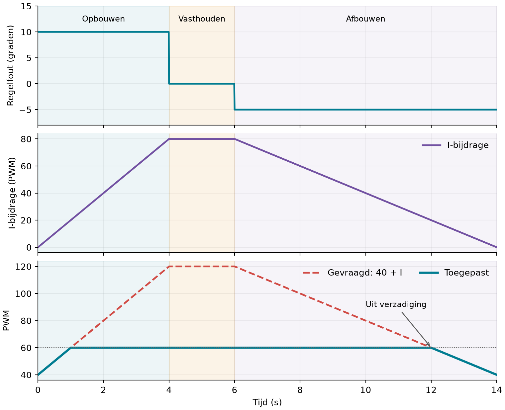

# PID-regeling van een aeropendulum

[Aangeleverde PDF openen](Aero_pendulum_PID.pdf)

Volg voor de opdrachten en codeverwijzingen deze webpagina. De aangeleverde PDF wijkt op enkele punten af van de Typst-bron waarop deze pagina is gebaseerd.

## Leerdoelen

- Je kunt uitleggen hoe terugkoppeling wordt gebruikt om de hoek van het aeropendulum te regelen.

- Je kunt de invloed van P, D en I op de beweging experimenteel onderzoeken.

- Je kunt verschillende vormen van demping herkennen en een PID-regelaar stapsgewijs afstellen.

- Je kunt meetgegevens in Python weergeven en de regeling beoordelen op overshoot, insteltijd en blijvende afwijking.

- Je kunt uitleggen wat softwarematige begrenzingen doen en waarom ook hardwarematige beveiliging nodig is.

!!! veiligheid "Veiligheid"

    1. Houd voldoende afstand van de draaiende propeller. Zorg dat handen, haar en losse voorwerpen buiten het bewegingsbereik blijven.

    1. Schakel de motorvoeding uit voordat je de bedrading, sensor of het Arduino-programma aanpast. Laat de opstelling en voedingsinstellingen controleren door de practicumbegeleider.

    1. Houd de uitschakeling van de motorvoeding bereikbaar. Schakel direct uit als de uitslagen steeds groter worden of de arm richting een mechanische aanslag beweegt.

    1. Wacht tot de propeller stilstaat voordat je de opstelling benadert. Twijfel je over een handeling? Vraag dit aan de practicumbegeleider.

## Introductie

In het open-looppracticum heb je onderzocht hoe het aeropendulum reageert op een ingestelde motoruitgang. Je koos een PWM-waarde en mat welke hoek de arm aannam. Voor een andere gewenste hoek moest je zelf een nieuwe instelling kiezen. Ook als de arm door een verstoring van positie veranderde, bleef de ingestelde motoruitgang gelijk.

Veel technische systemen moeten hun uitgang juist automatisch op een gewenste waarde houden. Denk aan de cruisecontrol van een auto. Wanneer de auto een helling oprijdt, is meer aandrijfkracht nodig om dezelfde snelheid te behouden. De cruisecontrol vergelijkt de gemeten snelheid met de ingestelde snelheid en past de aandrijving aan. Het steeds opnieuw meten, vergelijken en bijsturen noemen we *terugkoppeling*.

Bij het aeropendulum kunnen we hetzelfde principe gebruiken. We kiezen nu een gewenste hoek. De hoeksensor meet waar de arm zich bevindt en de regelaar past de motoruitgang aan. Staat de arm te laag, dan moet de propeller meer stuwkracht leveren. Nadert de arm de gewenste hoek, dan moet de regelaar op tijd terugregelen. De arm en motor reageren immers niet onmiddellijk: te laat terugregelen kan ervoor zorgen dat de arm doorschiet.

In dit practicum onderzoek je hoe je die correctie kunt verbeteren. Je begint met een eenvoudige P-regelaar, die reageert op het verschil tussen de gewenste en gemeten hoek. Daarna voeg je D toe om de beweging te dempen en I om een blijvende afwijking te verkleinen. Met je eigen metingen onderzoek je of de arm snel en rustig tot stilstand komt bij 30, 60 en 90 graden. Tot slot bekijk je hoe begrenzingen het regelgedrag en de veiligheid beïnvloeden.

*Leeswijzer.* Werk in `Arduino/Closed_loop/script.ipynb`: eerst de hoekmeting, daarna PID en meetdata, vervolgens de hoekgrens en PWM-stapbegrenzing. Alle proeven gebruiken `Stap_4_Closed_loop.ino`. Python verzorgt de instellingen en meetdata; de Arduino voert de regeling uit. De appendix bevat achtergrond en uitleg bij de Python-code.

## Theorie

### Van open loop naar terugkoppeling

De opstelling blijft hetzelfde als bij open loop: een propeller beweegt de arm omhoog en de zwaartekracht trekt de arm naar beneden. Het verschil zit in de aansturing. De motoruitgang wordt nu voortdurend aangepast aan de gemeten hoek. [Figuur 1](#fig-aeropid-regelkring) laat deze gesloten regelkring zien.

<figure id="fig-aeropid-regelkring" markdown="1">


<figcaption markdown="1">Figuur 1. Gesloten regelkring van het aeropendulum. De gemeten hoek wordt teruggekoppeld en vergeleken met de gewenste hoek.</figcaption>

</figure>

De gewenste hoek noemen we het *setpoint*, $r (t)$. De gemeten hoek schrijven we als $\theta (t)$. Beide hoeken meten we vanaf de verticale ruststand. Het verschil is de *regelfout*:

$$
e (t) = r (t) - \theta (t) .
$$

Bij een gewenste hoek van 60 graden en een gemeten hoek van 50 graden is de fout dus +10 graden. De arm staat nog te laag. Staat de arm op 65 graden, dan is de fout −5 graden en staat de arm te hoog.

### P: reageren op de afwijking

Een proportionele regelaar berekent een bijdrage die evenredig is met de fout:

$$
u_{P} (t) = K_{p} e (t) .
$$

De factor $K_{p}$ bepaalt hoe sterk de regelaar corrigeert. Bij dezelfde fout geeft een grotere P-waarde meer motoruitgang. De arm kan daardoor sneller omhoog bewegen, maar ook verder doorschieten en gaan oscilleren.

Met alleen P kan een blijvende afwijking ontstaan. Om de arm omhoog te houden is voortdurend stuwkracht nodig. Als de fout nul is, is de P-bijdrage ook nul. Een P-regelaar zonder extra basisuitgang heeft daarom een fout nodig om een niet-nul motoruitgang te leveren.

### D: de beweging dempen

De D-term reageert op hoe snel de hoek verandert. Beweegt de arm snel omhoog, dan vermindert deze bijdrage de motoruitgang al voordat de gewenste hoek is bereikt. Dat kan het doorschieten verminderen. In de gebruikte regeling geldt:

$$
u_{D} (t) = - K_{d} \frac{\mathrm{d} \theta}{\mathrm{d} t} .
$$

Een grotere D-waarde geeft meer tegenwerking bij dezelfde hoeksnelheid. Te veel D kan de respons traag maken en kleine schommelingen in de hoekmeting sterk laten doorwerken in de motoruitgang.

### I: een blijvende afwijking wegwerken

De I-term telt de fout in de tijd op:

$$
u_{I} (t) = K_{i} \int_{0}^{t} e (\tau) \, \mathrm{d} \tau .
$$

Blijft de arm onder het setpoint, dan groeit deze bijdrage totdat er voldoende motoruitgang is. De opgebouwde bijdrage kan daarna aanwezig blijven, ook wanneer de fout nul is. Zo kan I de blijvende afwijking van de P-regelaar verkleinen. Een te grote I-waarde kan echter opnieuw overshoot en oscillaties veroorzaken: een opgebouwde bijdrage verdwijnt niet meteen wanneer de arm het setpoint bereikt.

De PID-regelaar combineert deze drie bijdragen: $u (t) = u_{P} (t) + u_{D} (t) + u_{I} (t)$. De werkelijk toegepaste PWM is begrensd tussen nul en `max_pwm`. Een negatieve berekende uitgang kan de motor dus niet omgekeerd aandrijven. In het experiment stel je ze in die volgorde af. Zo kun je bij iedere stap zien wat de toegevoegde bijdrage verandert.

### De respons beoordelen

Een grafiek van de hoek tegen de tijd laat zien hoe de arm naar een nieuwe doelhoek beweegt. We noemen dit de *respons*. Om verschillende instellingen te vergelijken, kijken we naar drie eigenschappen:

- *Overshoot:* hoeveel graden de arm maximaal boven de doelhoek uitkomt.
- *Insteltijd:* de tijd die nodig is voordat de hoek binnen een afgesproken band rond het setpoint komt en daar gedurende de rest van de meting blijft.
- *Stationaire fout:* het verschil tussen het setpoint en de gemiddelde hoek nadat de beweging tot rust is gekomen.

Gebruik voor alle proeven dezelfde tolerantieband en vermeld de meetduur. Neem de overshoot als nul wanneer de arm niet boven het setpoint komt. Een stabiele eindhoek buiten de band heeft wel een stationaire fout, maar geen bereikte insteltijd. Als de respons nog niet stationair is, rapporteer je de stationaire fout als niet bepaald en verleng je zo nodig de meting.

Ook de vorm van de beweging is belangrijk. Een ondergedempte respons heeft uitdovende oscillaties. Bij een standaard tweedeordesysteem met vaste eigenfrequentie geeft kritische demping de snelste staprespons zonder overshoot. Een overgedempte respons nadert die eindwaarde langzamer, eveneens zonder oscillaties. Kritische demping is iets anders dan de grens van instabiliteit: bij die grens doven oscillaties juist niet meer uit.

<figure id="fig-ondergedempt" markdown="1">

{ width="85%" }

<figcaption markdown="1">Figuur 2. Ondergedempte respons bij een doelhoek van 60 graden. De arm schiet door en oscilleert met afnemende amplitude. De onderste grafiek laat zien hoe de PWM daarbij verandert.</figcaption>

</figure>

In [Figuur 2](#fig-ondergedempt) blijft de arm lange tijd heen en weer bewegen. In [Figuur 3](#fig-bijna-kritisch) nadert de arm dezelfde doelhoek veel rustiger. De tweede respons noemen we hier bijna kritisch gedempt: er is nog een kleine overshoot zichtbaar. De meting is daarmee een praktisch voorbeeld van rustig regelgedrag, geen bewijs van exact kritische demping. Het aeropendulum met motor en PID is bovendien ingewikkelder dan een ideaal tweedeordesysteem.

<figure id="fig-bijna-kritisch" markdown="1">

{ width="85%" }

<figcaption markdown="1">Figuur 3. Bijna kritisch gedempte respons bij een doelhoek van 60 graden: weinig overshoot en een snelle benadering van de doelhoek. Vergelijk zowel de hoek als de PWM met de ondergedempte respons.</figcaption>

</figure>

In opdracht 2 probeer je deze twee soorten respons zelf te maken. Het gaat om het herkennen en beïnvloeden van het gedrag; de precieze meetcurve hangt af van jouw opstelling en instellingen. De appendix geeft de verdere afleiding van de beweging en de invloed van motorvertraging op stabiliteit.

!!! voorbereiding "Voorbereiding"

    1. Installeer de Arduino IDE en de Python-omgeving op je laptop. Controleer of de Arduino Uno R4 Minima wordt herkend en dat de juiste poort kan worden geselecteerd [Link naar Arduino IDE](https://www.arduino.cc/en/software/).

    1. Installeer de bibliotheken `AS5600` en `PID_v1` (PID) in de Arduino IDE. Controleer de installatie door de meegeleverde stap-4-sketch te compileren; upload met uitgeschakelde motorvoeding.

    1. Clone of download de GitHub-repository van de practicumhandleiding. Controleer of de bestanden correct zijn gedownload en dat je toegang hebt tot de arduino- en pythonbestanden in de map. [Link naar github repository](https://github.com/HvA-TN/Practica)
    1. Leg in eigen woorden [Figuur 1](#fig-aeropid-regelkring) uit. Welke signalen worden gemeten en welke worden aangestuurd?

    1. Leg in eigen woorden uit wat P, D en I doen en hoe ze elkaar beïnvloeden. Gebruik de bewegingsvergelijking en de drie bijdragen van de PID-regelaar om dit te onderbouwen.

    1. Welke risico's voorzie je bij het experimenteren met een PID-regelaar? Beschrijf één concrete situatie waarbij actieve feedback gevaarlijk kan zijn. Welke voorzorgsmaatregelen kun je nemen? Welke rol hebben softwarematige en hardwarematige beveiliging hierbij? Onderbouw welke combinatie je zou gebruiken.

## Experiment

!!! opdracht "Opdracht 0: opstelling opbouwen en controleren"

    1. Bouw de opstelling op volgens [Tabel 1](#tab-aansluitingen). Laat de bedrading en voedingsinstellingen controleren. Spreek de maximale voedingsspanning en PWM af en noteer deze.

    1. Upload `Stap_4_Closed_loop.ino` met uitgeschakelde motorvoeding. Open `script.ipynb`, stel de juiste poort in en sluit Serial Monitor en Serial Plotter.

    1. Bepaal met *1. Hoek meten* de sensorhoek in de verticale ruststand. Gebruik deze als `beginhoek` en controleer de hoekmeting bij optillen.

    1. Controleer in *2. PID instellen* de werkhoek met `max_pwm=0` en de motorvoeding uit. Deze moet in rust ongeveer nul zijn en toenemen bij optillen. Je zult dit moeten corrigeren als dit niet klopt. Controleer voor iedere meetcel je eigen instellingen: het uitvoeren van de cel start ook de proef.

<span id="tab-aansluitingen"></span>

**Tabel 1.** Signaalaansluitingen van de Arduino naar de AS5600-hoeksensor en de L298N H-brug. Gebruik daarnaast de motor- en voedingsaansluitingen uit het [open-looppracticum](aeropendulum-openloop.md#app-schema), met een gemeenschappelijke GND.

| *Van Arduino* | *Draadkleur* | *Naar component* | *Aansluiting* |
| --- | --- | --- | --- |
| GND (Analog) | Zwart | Hoeksensor | GND |
| 3.3 V | Rood | Hoeksensor | VCC |
| A4 | Groen | Hoeksensor | SDA |
| A5 | Wit | Hoeksensor | SCL |
| D9 (digitaal, PWM) | Paars | H-brug | ENA |
| D10 (digitaal) | Oranje | H-brug | IN1 |
| D11 (digitaal) | Geel | H-brug | IN2 |

!!! opdracht "Opdracht 1: P-regeling onderzoeken"

    1. Kies een doelhoek van 30 graden en begin met een kleine P-waarde, met I en D op nul. Gebruik de afgesproken PWM-grens. Voorspel de respons.

    1. Onderzoek minstens vijf P-waarden vanuit dezelfde beginstand. Houd de overige instellingen gelijk. Bewaar de meetdata en instellingen (`opslaan=True`).

    1. Maak vergelijkbare grafieken van hoek, setpoint en PWM tegen de tijd. Bepaal overshoot, insteltijd en stationaire fout.

    1. Onderzoek binnen de veilige grenzen wanneer oscillaties niet meer uitdoven. Stop direct bij sterk toenemende uitslagen; vermeld wanneer de veilige grens verder onderzoek verhindert.

    1. Verklaar je waarnemingen met de theorie en vergelijk ze met je voorspelling. Betrek de stabiliteitsafleiding in de appendix bij je verklaring.

!!! opdracht "Opdracht 2: P, D en I afstellen en de voorbeeldfiguren namaken"

    1. Begin bij 60 graden met een P-instelling uit opdracht 1 en controleer opnieuw de stabiliteit. Onderzoek vervolgens de invloed van D en daarna van I. Verander telkens slechts een parameter.

    1. Maak met eigen metingen de twee soorten respons uit [Figuur 2](#fig-ondergedempt) en [Figuur 3](#fig-bijna-kritisch) na. Onderbouw je keuze van de instellingen.

    1. Vergelijk de responsen in grafieken met gelijke asschalen. Bepaal overshoot, insteltijd en stationaire fout en beoordeel de demping. Leg instellingen en resultaten vast in je labjournaal, inclusief doelhoek, P, I, D, regelinterval en ingestelde grenzen.

    1. Onderzoek of je de arm ook op 90 graden kunt stabiliseren. Welke aanpassingen zijn nodig en hoe verklaar je die?

## Veiligheid bij PID-regeling

Een regeling die uiteindelijk de juiste waarde bereikt, kan onderweg toch een gevaarlijke situatie veroorzaken. Denk aan een drukinstallatie: als een pomp te lang blijft toevoeren, kan de druk boven de toegestane waarde uitkomen. Het later herstellen van de druk maakt die overschrijding niet ongedaan. Ook bij het aeropendulum kan overshoot ongewenst zijn, bijvoorbeeld wanneer de arm een mechanische aanslag raakt.

*Softwarematige beveiliging* gebruikt metingen om in te grijpen. Je kunt bijvoorbeeld de motor uitschakelen wanneer een maximale hoek wordt gemeten, of voorkomen dat de motoruitgang te snel toeneemt. Dit werkt alleen als de sensor, het programma en de aansturing correct functioneren. Bovendien verdwijnt de beweging niet meteen als de motor wordt uitgeschakeld: de arm kan door zijn snelheid nog verder bewegen. Ook het meetinterval en de verwerking kosten tijd: een grensoverschrijding wordt niet onmiddellijk gedetecteerd. Een PWM-stapbegrenzing beïnvloedt de aansturing, maar garandeert op zichzelf geen veilige hoek.

*Hardwarematige beveiliging* kan onafhankelijk van het regelprogramma ingrijpen. Voorbeelden zijn een noodstop die de motorvoeding onderbreekt en een eindschakelaar die de aandrijving rechtstreeks uitschakelt. Afscherming beperkt de kans op contact met de propeller. Bij drukinstallaties kan een geschikt veiligheidsventiel overdruk afvoeren (overdrukventiel). Welke voorziening nodig is, hangt af van het gevaar en de opgeslagen energie. Beoordeel daarom naast het regelgedrag ook wat er bij een storing kan gebeuren.

In de volgende opdrachten onderzoek je twee softwarematige maatregelen. Eerst test je een stop bij overschrijding van de hoekgrens, daarna een begrenzing van de PWM-toename. Beoordeel telkens zowel de invloed op de beweging als de beperkingen van de maatregel.

!!! opdracht "Opdracht 3: maximale hoek van 100 graden"

    1. Gebruik 4. Hoekgrens instellen met kies zelf een maximale hoek. Neem je eigen nulstand en PID-instellingen over en kies zelf een geschikte doelhoek.

    1. Test de hoekstop eerst met uitgeschakelde motorvoeding en `max_pwm=0`. Beweeg de arm alleen voorbij de grens als dit mechanisch mogelijk is. Noteer je voorspelling en waarneming.

    1. Herstel de afgesproken PWM-grens en vergelijk de respons bij 90 graden met opdracht 2. Onderzoek of je de regeling kunt verbeteren. Lok met draaiende propeller geen overschrijding uit.

    1. Beoordeel de beperkingen van deze beveiliging. Welke aanvullende hardwarematige voorziening zou je kiezen en waarom?

!!! opdracht "Opdracht 4: de PWM-toename per tijdstap verkleinen"

    1. Gebruik 5. PWM-stap begrenzen met dezelfde sketch en je eigen instellingen. Behoud de hoekgrens van 100 graden. Maak bij 60 graden een referentiemeting met `max_pwm_stap=0` (begrenzing uit).

    1. Onderzoek verschillende positieve waarden van `max_pwm_stap`. Deze begrenst alleen de stijging per regelstap; dalen en stoppen gaan direct. Houd de overige instellingen gelijk en voorspel telkens de respons.

    1. Vergelijk hoek en PWM met de referentiemeting. Onderzoek ook welke rol `delta_t` speelt. Onderbouw je conclusie met de meetgegevens.

    1. Stel de PID-regelaar opnieuw af voor een gekozen stapgrens en test bij 30, 60 en 90 graden. Herhaal je eindinstellingen minstens drie keer. Verklaar wanneer stabiliseren wel of niet lukt.

!!! afronding "Afronding"

    1. Schakel de motorvoeding uit en wacht tot de propeller stilstaat. Laat de meetresultaten controleren door de practicumbegeleider.

    1. Voeg de grafieken en parametertabellen toe aan je digitale labjournaal. Geef iedere figuur een duidelijk onderschrift met de gebruikte instellingen.

    1. Beschrijf in *Resultaten en Discussie* hoe P, D en I de respons beïnvloedden.

    1. Bespreek de invloed en beperkingen van de hoekstop en de PWM-stapbegrenzing. Vergelijk je conclusies met je verwachtingen uit de voorbereiding.

    1. Doe eventueel eerst het onderdeel *Extra* hieronder. Breek daarna de opstelling af en ruim de werkplek op. Controleer of alle componenten compleet zijn.

## Extra: Arduino aanpassen met PlatformIO

Met de extensie *PlatformIO IDE* kun je de Arduino-code vanuit VS Code aanpassen, compileren en uploaden.

1. Installeer de extensie en maak via *PlatformIO Home > New Project* een project voor *Arduino Uno R4 Minima*, met framework *Arduino*.
1. Verwijder de gegenereerde `src/main.cpp` en kopieer `Stap_4_Closed_loop.ino` naar `src`. Laat de extensie `.ino` behouden. Voeg via *Libraries > Add to Project* de bibliotheken *AS5600* van Rob Tillaart en *PID* van Brett Beauregard toe.
1. Kies *Project Tasks > Build*. Los eventuele compilatiefouten op voordat je verdergaat.
1. Pas in je kopie de precisie van de verzonden werkhoek aan: verander `Serial.print(werkhoek, 3)` naar `Serial.print(werkhoek, 1)`. Voorspel wat je in de meetdata terugziet.
1. Schakel de motorvoeding uit, verbind de Arduino via USB en sluit actieve notebookmetingen en seriële monitors. Kies *Upload* in PlatformIO. Controleer daarna in de notebook de meting met `max_pwm=0`. Zet de wijziging terug en upload opnieuw.

Lukt uploaden niet? Controleer eerst het gekozen board, de USB-verbinding en of een ander programma de poort gebruikt. De basisinstellingen in `platformio.ini` zijn:

```ini
[env:uno_r4_minima]
platform = renesas-ra
board = uno_r4_minima
framework = arduino
```

Laat de door *Add to Project* toegevoegde `lib_deps` staan. Meer uitleg: [PlatformIO in VS Code](https://docs.platformio.org/en/latest/integration/ide/vscode.html) en [Uno R4 Minima](https://docs.platformio.org/en/latest/boards/renesas-ra/uno_r4_minima.html).

## Appendix: Materialenlijst
- Arduino Uno R4 Minima;
- L298N H-brug;
- AS5600 magnetische hoeksensor;
- Elektromotor met propeller;
- Externe voeding;
- USB-C kabel en koppelstuk;
- Platform met paal en 3D geprint aansluitstuk, arm met draaipunt en magneet;
- Diverse aansluitdraden (Male-Male, Male-Female, Female-Female);
- Laptop of computer met Arduino IDE en Python 3.11+;

## Appendix: Python-aansturing en meetdata

De functies staan in `Arduino/Closed_loop/closed_loop/meting.py`. Je hoeft deze module niet aan te passen. `test_hoek` meet de ruwe sensorhoek met de motoruitgang op nul. `voer_pid_meting_uit` stuurt de instellingen naar de Arduino en retourneert twee resultaten: de meetpunten en het pad naar de CSV (of `None` als opslaan uitstaat). Elk PID-meetpunt bevat achtereenvolgens tijd in seconden, doelhoek, werkhoek in graden en toegepaste PWM.

De werkhoek is de sensorhoek minus `beginhoek`, omgerekend naar het bereik van -180 tot 180 graden. De CSV bevat de kolommen `tijd`, `hoek` en `pwm`; de doelhoek en andere instellingen staan in de commentaarheader. Daarom gebruikt de notebook `pd.read_csv(bestand, comment="#")`. Zonder CSV maakt de notebook een DataFrame uit de vier waarden in het geheugen.

Voor CSV-opslag in de hoekgrenscel moet ook `opslaan=opslaan` aan de functieaanroep worden toegevoegd en de variabele op `True` staan.

Na de hoekgrensproef of de begrensde proef kun je met onderstaande cel de juiste meetreeks selecteren. De oorspronkelijke cel Meetdata bekijken verwijst alleen naar de eerste PID-meting.

**Meetgegevens van de vervolgproeven bekijken**

```python
# Kies de hoekgrensproef:
punten, bestand = metingen_veiligheid, csv_pad_veiligheid
# Of kies de proef met PWM-stapbegrenzing:
# punten, bestand = metingen_begrensd, csv_pad_begrensd

if bestand is None:
    df = pd.DataFrame(
        punten, columns=["tijd", "doelhoek", "hoek", "pwm"]
    )
else:
    df = pd.read_csv(bestand, comment="#")
display(df.head())
```

Bij een fout, zoals de hoekstop, keert de functie niet normaal terug: de resultaatvariabelen worden dan niet bijgewerkt en kunnen nog data van een vorige proef bevatten. Met `opslaan=True` worden reeds ontvangen meetpunten wel bewaard; lees in dat geval het CSV-pad uit de uitvoer en laad dat bestand expliciet.

### Stoppen en communicatie

Met `mode="fixed"` stopt de proef na `meetduur`; met `mode="continuous"` onderbreek je de notebookcel om te stoppen. Python verstuurt tijdens het meten ongeveer iedere halve seconde `PING`. De Arduino schakelt de motor uit als er langer dan drie seconden geen heartbeat is ontvangen. Daarnaast probeert Python bij afronding, onderbreking of een fout altijd `STOP` te versturen. De volgende ingekorte passage uit de meetfunctie laat dit zien:

**Stopcommando bij afsluiten van de meting**

```python
finally:
    try:
        _stuur(arduino, "STOP")
        arduino.flush()
    except (serial.SerialException, OSError) as exc:
        print(f"STOP kon niet worden verzonden: {exc}")
```

Dit fragment hoort bij de functie in de module en is geen losse notebookcel. Blijf bij onverwacht gedrag de motorvoeding zelf uitschakelen. De hoekgrens stopt de motor bij een gemeten werkhoek boven `max_hoek`; de PWM-stapgrens beperkt uitsluitend de stijging van de uitgang. Geen van beide neemt de bewegingsenergie van de arm direct weg.

## Appendix: Afleiding bewegingsvergelijking

### Bewegingsvergelijking van het aeropendulum (open loop)
We beschouwen een aeropendulum bestaande uit een roterende arm met een propeller. De propeller levert een stuwkracht waardoor de arm om zijn draaipunt roteert.

Volgens de tweede wet van Newton voor rotaties geldt:

$$
\sum \tau = J \ddot{\theta} . \tag{1}
$$

Hierin is $J$ het traagheidsmoment rond het draaipunt en $\theta$ de hoek van de arm ten opzichte van de verticale evenwichtspositie.

Op de arm werken drie koppels:

- Het motorkoppel door de stuwkracht van de propeller.
- Het zwaartekrachtsmoment.
- Het dempende koppel door wrijving.

Het motorkoppel schrijven we als $\tau_{T} = l_{T} F_{T}$, waarbij $l_{T}$ de afstand tussen het draaipunt en de aangrijpingslijn van de stuwkracht is. Het zwaartekrachtsmoment is: $\tau_{g} = - m g l \sin (\theta)$. Hierin is $l$ de afstand van het draaipunt tot het massamiddelpunt. We modelleren de wrijving als een krachtmoment dat evenredig is met de hoeksnelheid: $\tau_{w} = - b \dot{\theta}$.

De bewegingsvergelijking wordt daarmee:

$$
J \ddot{\theta} = l_{T} F_{T} - b \dot{\theta} - m g l \sin (\theta) \tag{2}
$$

Of, na herschikken:

$$
J \ddot{\theta} + b \dot{\theta} + m g l \sin (\theta) = l_{T} F_{T} \tag{3}
$$

#### Relatie tussen PWM en stuwkracht

We nemen aan dat de stuwkracht direct en lineair[^1]. afhangt van de PWM-waarde $u$:

$$
F_{T} = k_{u} u \tag{4}
$$

Hierin is $k_{u}$ een evenredigheidsconstante. We defineren nu $A = l_{T} k_{u}$, zodat het motorkoppel kan worden geschreven als $\tau_{T} = A u$.
Daarmee wordt de bewegingsvergelijking:

$$
\boxed{J \ddot{\theta} + b \dot{\theta} + m g l \sin (\theta) = A u} \tag{5}
$$

Dit is een niet-lineaire differentiaalvergelijking van de tweede orde. In deze afleiding zijn hoeken in radialen; de notebook gebruikt graden. Numerieke regelversterkingen kun je daarom alleen vergelijken na omzetting naar dezelfde hoekeenheid.

### De P-regelaar

We willen de pendulum stabiliseren rond een gewenste hoek $\theta_{r}$. De fout tussen de gewenste en de gemeten hoek is:

$$
e (t) = \theta_{r} - \theta (t) \tag{6}
$$

Een proportionele regelaar past de PWM-waarde aan op basis van deze fout:

$$
u (t) = u_{0} + K_{p} e (t) \tag{7}
$$

In deze afleiding nemen we een extra evenwichtsaansturing $u_{0}$ aan. De gebruikte sketch heeft geen afzonderlijke instelling voor deze basisuitgang: bij P-regeling ontstaat de benodigde uitgang door een blijvende fout, en bij PID kan de I-term deze leveren.

Hierin zijn:

- $u_{0}$: de PWM-waarde die nodig is om de gewenste hoek vast te houden.
- $K_{p}$: de proportionele versterking.

We nemen aan dat de gewenste hoek constant is.

Bij de gewenste hoek $\theta_{0} = \theta_{r}$ is de pendulum in evenwicht. De hoeksnelheid en hoekversnelling zijn dan nul:

$$
\dot{\theta} = 0 , \quad \ddot{\theta} = 0 \tag{8}
$$

Uit de bewegingsvergelijking volgt:

$$
m g l \sin (\theta_{0}) = A u_{0} \tag{9}
$$

De PWM-waarde die nodig is om dit evenwicht te handhaven is dus:

$$
u_{0} = (m g l \sin (\theta_{0})) / A \tag{10}
$$

We combineren deze evenwichtsaansturing met de P-regelaar:

$$
u (t) = u_{0} + K_{p} (\theta_{r} - \theta (t)) \tag{11}
$$

### Kleine afwijkingen rond het evenwicht

We onderzoeken wat er gebeurt als de pendulum een kleine afwijking heeft ten opzichte van de gewenste hoek.

Schrijf de werkelijke hoek als:

$$
\theta (t) = \theta_{0} + \epsilon (t) \tag{12}
$$

Hierin is $\epsilon (t)$ de kleine afwijking van de evenwichtshoek.

Omdat $\theta_{r} = \theta_{0}$, geldt:

$$
e (t) = - \epsilon (t) \tag{13}
$$

De regelaar wordt daarmee:

$$
u (t) = u_{0} - K_{p} \epsilon (t) \tag{14}
$$

Vul dit in bij de bewegingsvergelijking:

$$
J \ddot{\theta} + b \dot{\theta} + m g l \sin (\theta) = A (u_{0} - K_{p} \epsilon) \tag{15}
$$

Omdat $\theta = \theta_{0} + \epsilon$ en $\theta_{0}$ constant is, geldt:

$$
\begin{aligned} \dot{\theta} & = \dot{\epsilon} \\ \ddot{\theta} & = \ddot{\epsilon} \end{aligned} \tag{16}
$$

We krijgen:

$$
J \ddot{\epsilon} + b \dot{\epsilon} + m g l \sin (\theta_{0} + \epsilon) = A u_{0} - A K_{p} \epsilon \tag{17}
$$

#### Linearisatie

Voor kleine afwijkingen $\epsilon$ kunnen we de sinusfunctie benaderen met een Taylorontwikkeling:

$$
\sin (\theta_{0} + \epsilon) \approx \sin (\theta_{0}) + \epsilon \cos (\theta_{0})
$$

Invullen geeft:

$$
J \ddot{\epsilon} + b \dot{\epsilon} + m g l \sin (\theta_{0}) + m g l \cos (\theta_{0}) \epsilon = A u_{0} - A K_{p} \epsilon
$$

We weten dat in het evenwicht geldt:

$$
m g l \sin (\theta_{0}) = A u_{0}
$$

Deze constante termen vallen dus tegen elkaar weg.

Daarmee vinden we:

$$
J \ddot{\epsilon} + b \dot{\epsilon} + m g l \cos (\theta_{0}) \epsilon = - A K_{p} \epsilon \tag{18}
$$

Breng alle termen naar de linkerkant:

$$
\boxed{J \ddot{\epsilon} + b \dot{\epsilon} + (m g l \cos (\theta_{0}) + A K_{p}) \epsilon = 0} \tag{19}
$$

Dit is de gelineariseerde bewegingsvergelijking van de P-geregelde aeropendulum.

### Eigenfrequenties van aeropendulum
Om het frequentiegedrag van het systeem te analyseren, herschrijven we de bewegingsvergelijking in de standaardvorm van een gedempte harmonische oscillator:

$$
J \ddot{\epsilon} + b \dot{\epsilon} + (m g l \cos (\theta_{0}) + A K_{p}) \epsilon = 0 \tag{20}
$$

We noteren $k_{\text{eff}} = m g l \cos (\theta_{0}) + A K_{p}$ als de effectieve stijfheid van het systeem en delen we door $J$. De bewegingsvergelijking wordt dan:

$$
\ddot{x} + b / J \dot{x} + k_{\text{eff}} / J x = 0 .
$$

Dit lijkt al bijna op de standaardvorm van een gedempte harmonische oscillator. We vergelijken dit met de algemene vorm:

$$
\ddot{x} + 2 \zeta \omega_{0} \dot{x} + \omega_{0}^{2} x = 0
$$

!!! note "De harmonische oscillator en stabiliteit"

    Een gedempte harmonische oscillator beschrijft een systeem waarin een herstellende kracht en een dempende kracht werkzaam zijn. Een bekend voorbeeld is een massa aan een veer.

    De bewegingsvergelijking luidt:

    $$
    m \ddot{x} + b \dot{x} + k x = 0
    $$

    Hierin is $m$ de massa, $b$ de dempingscoëfficiënt en $k$ de veerconstante.

    De herstellende kracht $F = - k x$ werkt de uitwijking tegen, terwijl de dempende kracht $F = - b \dot{x}$ de beweging tegenwerkt.

    ### Eigenfrequentie en demping

    De ongedempte eigenhoekfrequentie wordt gegeven door:

    $$
    \omega_{0} = \sqrt{k / m}
    $$

    De dimensieloze dempingsratio is:

    $$
    \zeta = b / (2 \sqrt{m k})
    $$

    Voor $m > 0$ en $k > 0$ onderscheiden we drie situaties:

    - *Ondergedempt* ($0 < \zeta < 1$): het systeem oscilleert rond de evenwichtspositie, waarbij de amplitude geleidelijk afneemt.
    - *Kritisch gedempt* ($\zeta = 1$): het systeem keert zonder oscillaties zo snel mogelijk terug naar de evenwichtspositie.
    - *Overgedempt* ($\zeta > 1$): het systeem keert zonder oscillaties terug naar de evenwichtspositie, maar langzamer dan bij kritische demping.

    ### Stabiliteit

    Voor het ondergedempte geval is de oplossing:

    $$
    x (t) = X_{0} e^{- b / (2 m) t} \cos (\omega_{d} t + \phi)
    $$

    met de gedempte eigenhoekfrequentie:

    $$
    \omega_{d} = \sqrt{k / m - b^{2} / (4 m^{2})}
    $$

    De exponentiële factor bepaalt hoe de amplitude zich ontwikkelt:

    $$
    X (t) = X_{0} e^{- b / (2 m) t}
    $$

    Hieruit volgt:

    - Bij $b > 0$ neemt de amplitude af: de oscillaties doven uit.
    - Bij $b = 0$ blijft de amplitude constant: het systeem oscilleert zonder energieverlies.
    - Bij $b < 0$ neemt de amplitude toe: het systeem is instabiel.

    Deze uitspraken over de amplitude gelden voor oscillerende oplossingen. Voor $k > 0$ is het evenwicht bij $b > 0$ asymptotisch stabiel, ook wanneer het systeem niet oscilleert.

De frequentie van het P-geregelde aeropendulum wordt bepaald door de effectieve stijfheid $k_{\text{eff}}$ en het traagheidsmoment $J$:

$$
\boxed{\omega_{0}^{2} = (m g l \cos (\theta_{0}) + A K_{p}) / J}
$$

De relatieve demping hangt af van $b$, $J$ en de effectieve stijfheid:

$$
\boxed{\zeta = b / (2 \sqrt{J (m g l \cos (\theta_{0}) + A K_{p})}) .}
$$

#### Invloed van de proportionele versterking

Als we $K_{p}$ verhogen, neemt de effectieve stijfheid dus toe.

Hierdoor:

- Neemt de eigenfrequentie $\omega_{0}$ toe.
- Neemt de relatieve demping $\zeta$ af.
- Worden de oscillaties sneller.
- Kan de overshoot bij een verandering van het setpoint toenemen.

Een kleinere dempingsratio betekent echter niet automatisch dat het systeem instabiel wordt. Hoe kan het dan dat een te grote proportionele versterking in de praktijk toch instabiliteit kan veroorzaken?

#### Invloed van een vertraagde kracht

Tot nu toe hebben we aangenomen dat de stuwkracht van de motor onmiddellijk verandert wanneer de proportionele regelaar de PWM-waarde aanpast. In werkelijkheid heeft de motor echter een eindige reactietijd. Wanneer de regelaar de PWM-waarde verhoogt, duurt het enige tijd voordat de motor versnelt en de stuwkracht toeneemt.

Dit betekent dat de motor nog een relatief grote kracht kan leveren op het moment dat de pendulum de gewenste hoek al heeft bereikt. De regelaar probeert de motor dan af te remmen, maar de stuwkracht reageert vertraagd. Hierdoor kan de pendulum doorschieten.

Om dit effect te beschrijven, introduceren we een tijdconstante $\tau_{m}$ voor de motor. We nemen aan dat de werkelijke stuwkracht $F_{T}$ de gewenste stuwkracht $F_{\text{gewenst}}$ volgt volgens:

$$
\tau_{m} \dot{F_{T}} + F_{T} = F_{\text{gewenst}} \tag{21}
$$

Dit is een eersteorde-differentiaalvergelijking. De tijdconstante $\tau_{m}$ bepaalt hoe snel de motor reageert. Na één tijdconstante heeft de stuwkracht ongeveer 63% van een opgelegde stapverandering bereikt.

Bij een P-regelaar is de gewenste stuwkracht afhankelijk van de afwijking $\epsilon$ ten opzichte van de evenwichtshoek:

$$
F_{\text{gewenst}} = F_{0} - k_{u} K_{p} \epsilon \tag{22}
$$

Hierin is $F_{0}$ de stuwkracht die nodig is om de pendulum in evenwicht te houden.

We schrijven de werkelijke stuwkracht als:

$$
F_{T} = F_{0} + f
$$

waarbij $f$ de afwijking van de evenwichtsstuwkracht is.

Invullen in het motormodel geeft:

$$
\tau_{m} \dot{f} + f = - k_{u} K_{p} \epsilon \tag{23}
$$

Vermenigvuldig met de motorarm $l_{T}$ en gebruik $A = l_{T} k_{u}$. We definiëren bovendien het afwijkende motorkoppel $q = l_{T} f$.

Daarmee wordt:

$$
\tau_{m} \dot{q} + q = - A K_{p} \epsilon \tag{24}
$$

#### De nieuwe bewegingsvergelijking

De bewegingsvergelijking van de gelineariseerde pendulum is:

$$
J \ddot{\epsilon} + b \dot{\epsilon} + m g l \cos (\theta_{0}) \epsilon = q \tag{25}
$$

Voor het gemak definiëren we:

$$
B = m g l \cos (\theta_{0})
$$

We hebben nu twee gekoppelde differentiaalvergelijkingen die samen de beweging van de pendulum en de respons van de motor beschrijven:

$$
J \ddot{\epsilon} + b \dot{\epsilon} + B \epsilon = q \tag{26}
$$

$$
\tau_{m} \dot{q} + q = - A K_{p} \epsilon \tag{27}
$$

Om deze vergelijkingen samen te voegen, gebruiken we eliminatie door substitutie. Uit de eerste vergelijking drukken we het motorkoppel $q$ uit in termen van de hoek $\epsilon$ en haar afgeleiden. Door deze uitdrukking naar de tijd te differentiëren, vinden we ook een uitdrukking voor $\dot{q}$.

Vervolgens substitueren we beide uitdrukkingen in de tweede vergelijking. Hiermee elimineren we de variabele $q$ en verkrijgen we één differentiaalvergelijking voor de hoekafwijking $\epsilon$:

$$
\boxed{\tau_{m} J \dddot{\epsilon} + (J + \tau_{m} b) \ddot{\epsilon} + (b + \tau_{m} B) \dot{\epsilon} + (B + A K_{p}) \epsilon = 0} \tag{28}
$$

De resulterende vergelijking is van de derde orde, terwijl de oorspronkelijke bewegingsvergelijking van de pendulum van de tweede orde was. De extra orde ontstaat doordat de motor een eigen dynamische toestand heeft: de stuwkracht kan niet onmiddellijk veranderen, maar ontwikkelt zich in de tijd.

#### Wanneer ontstaat instabiliteit?

Om de stabiliteit te onderzoeken, gebruiken we het Routh-Hurwitz-criterium. Deze wiskundige methode bepaalt of een lineair systeem stabiel is aan de hand van de coëfficiënten van zijn karakteristieke vergelijking. We hoeven hiervoor de differentiaalvergelijking niet volledig op te lossen.

We zoeken oplossingen van de vorm:

$$
\epsilon (t) = C e^{\lambda t} \tag{29}
$$

Hierin bepaalt de exponent $\lambda$ het gedrag van de beweging. In het algemeen kan $\lambda$ complex zijn:

- Als alle oplossingen voor $\lambda$ een negatief reëel deel hebben, doven verstoringen uit en is het systeem asymptotisch stabiel.
- Als minstens één oplossing een positief reëel deel heeft, groeit een verstoring en is het systeem instabiel.
- Als een oplossing een reëel deel gelijk aan nul heeft, bevindt het systeem zich mogelijk op een stabiliteitsgrens.

Door de exponentiële oplossing in de bewegingsvergelijking te substitueren en de gemeenschappelijke factor $C e^{\lambda t}$ weg te delen, vinden we de karakteristieke vergelijking:

$$
\tau_{m} J \lambda^{3} + (J + \tau_{m} b) \lambda^{2} + (b + \tau_{m} B) \lambda + (B + A K_{p}) = 0 \tag{30}
$$

!!! note "Het Routh-Hurwitz-criterium"

    Het Routh-Hurwitz-criterium is een wiskundige methode waarmee we de stabiliteit van een lineair dynamisch systeem kunnen bepalen, zonder de bijbehorende differentiaalvergelijking expliciet op te lossen.

    We beschouwen een differentiaalvergelijking van de derde orde:

    $$
    a_{3} \dddot{x} + a_{2} \ddot{x} + a_{1} \dot{x} + a_{0} x = 0 \tag{31}
    $$

    We zoeken oplossingen van de vorm $x (t) = C e^{\lambda t}$. Substitutie levert de karakteristieke vergelijking:

    $$
    a_{3} \lambda^{3} + a_{2} \lambda^{2} + a_{1} \lambda + a_{0} = 0 \tag{32}
    $$

    De oplossingen voor $\lambda$ bepalen het gedrag van het systeem. Een systeem is asymptotisch stabiel wanneer alle oplossingen een negatief reëel deel hebben. In dat geval doven kleine verstoringen uiteindelijk uit.

    Het Routh-Hurwitz-criterium stelt dat voor een derdeorde-systeem met $a_{3} > 0$ aan de volgende voorwaarden moet worden voldaan:

    $$
    a_{2} > 0 , \quad a_{1} > 0 , \quad a_{0} > 0 \tag{33}
    $$

    Daarnaast geldt de aanvullende voorwaarde:

    $$
    \boxed{a_{2} a_{1} > a_{3} a_{0}} \tag{34}
    $$

    Wanneer aan al deze voorwaarden wordt voldaan, liggen alle wortels van de karakteristieke vergelijking in het linkerhalfvlak van het complexe vlak. Het systeem is dan asymptotisch stabiel.

    *Conclusie:* we kunnen de stabiliteit rechtstreeks uit de coëfficiënten bepalen, zonder de drie wortels van de karakteristieke vergelijking te berekenen.

#### Toepassing op de aeropendulum

Voor onze bewegingsvergelijking identificeren we de coëfficiënten:

$$
a_{3} = \tau_{m} J , \quad a_{2} = J + \tau_{m} b
$$

$$
a_{1} = b + \tau_{m} B , \quad a_{0} = B + A K_{p}
$$

We nemen $J$, $b$, $A$ en $\tau_{m}$ positief en $K_{p} \ge 0$. Voor evenwichtshoeken onder 90 graden is $B > 0$ en zijn alle coëfficiënten positief. Bij 90 graden is $B = 0$; dan is bovendien $K_{p} > 0$ nodig.

De stabiliteit wordt dus volledig bepaald door de aanvullende voorwaarde van het Routh-Hurwitz-criterium:

$$
\boxed{(J + \tau_{m} b) (b + \tau_{m} B) > \tau_{m} J (B + A K_{p})} \tag{35}
$$

Deze ongelijkheid laat zien dat een grotere proportionele versterking $K_{p}$ de stabiliteit kan verminderen. De rechterkant neemt immers toe met $K_{p}$, terwijl de linkerkant constant blijft.

Er bestaat daarom een kritische versterking waarbij de ongelijkheid overgaat in een gelijkheid. Dit is de grens tussen asymptotische stabiliteit en instabiliteit.

#### Kritische proportionele versterking

De stabiliteitsvoorwaarde laat zien dat een grotere proportionele versterking $K_{p}$ uiteindelijk tot instabiliteit kan leiden. De grens tussen stabiliteit en instabiliteit vinden we door de ongelijkheid te vervangen door een gelijkheid:

$$
(J + \tau_{m} b) (b + \tau_{m} B) = \tau_{m} J (B + A K_{p , \text{krit}}) \tag{36}
$$

Hierin is $K_{p , \text{krit}}$ de kritische proportionele versterking: de waarde waarbij het systeem zich precies op de stabiliteitsgrens bevindt.

Door de vergelijking op te lossen naar $K_{p , \text{krit}}$ vinden we:

$$
K_{p , \text{krit}} = 1 / A (((J + \tau_{m} b) (b + \tau_{m} B)) / (\tau_{m} J) - B) \tag{37}
$$

Na vereenvoudiging volgt:

<span id="eq-kritische-versterking"></span>

$$
\boxed{K_{p , \text{krit}} = b / A (1 / \tau_{m} + b / J + (\tau_{m} B) / J)} \tag{38}
$$

Onder de bovenstaande voorwaarden onderscheiden we drie situaties:

- *$K_{p} < K_{p , \text{krit}}$*: het systeem is asymptotisch stabiel. Kleine verstoringen doven uiteindelijk uit.
- *$K_{p} = K_{p , \text{krit}}$*: het systeem bevindt zich op de stabiliteitsgrens. Er kunnen oscillaties met constante amplitude optreden.
- *$K_{p} > K_{p , \text{krit}}$*: het systeem is instabiel. Kleine verstoringen kunnen in de tijd groeien.

#### Fysische interpretatie

De kritische versterking hangt af van zowel de mechanische eigenschappen van de pendulum als de responstijd van de motor. Zonder gemeten modelparameters kun je [vergelijking (38)](#eq-kritische-versterking) niet betrouwbaar numeriek invullen. De belangrijkste conclusie is: als de motor te traag reageert, kan een te grote proportionele versterking leiden tot instabiliteit. De motor kan dan op het verkeerde moment energie aan de beweging toevoegen, waardoor de oscillaties toenemen in plaats van afnemen.

### PID-regeling en integral windup

*Integral windup* ontstaat wanneer de integrator fout blijft optellen terwijl de actuator de gevraagde aansturing niet kan uitvoeren. De opgebouwde I-bijdrage kan dan groter worden dan nodig is. Ook als de fout later klein of nul wordt, is die bijdrage niet direct verdwenen. Dit kan de terugkeer naar het setpoint vertragen en overshoot veroorzaken.

We leiden dit hieronder af met Laplace. Eerst beschrijven we de lineaire integrator; daarna voegen we de uitgangsbegrenzing toe. Voor de regels van de Laplacetransformatie, zie Brightspace.

#### De integrator onthoudt de fout

De regelfout is $e (t) = r (t) - \theta (t)$. We schrijven de I-bijdrage direct in PWM-telwaarden als $i (t)$:

$$
i (t) = i_{0} + K_{i} \int_{0}^{t} e (\tau) \mathrm{d} \tau , \quad \dot{i} (t) = K_{i} e (t) . \tag{39}
$$

Hierin is $i_{0} = i (0)$ de al aanwezige I-bijdrage. Een positieve fout laat $i$ toenemen, een negatieve fout laat $i$ afnemen. Bij nul fout blijft $i$ gelijk: de integrator wordt niet vanzelf gereset.

Noem de Laplacetransformaties van $e (t)$ en $i (t)$ respectievelijk $E (s)$ en $I (s)$. De transformatieregel voor een afgeleide geeft:

$$
s I (s) - i_{0} = K_{i} E (s) . \tag{40}
$$

Dus:

$$
\boxed{I (s) = K_{i} / s E (s) + i_{0} / s} . \tag{41}
$$

De factor $K_{i} / s$ is de overdrachtsfunctie van de integrator bij nulbeginvoorwaarde. De term $i_{0} / s$ beschrijft het geheugen waarmee een nieuw tijdsinterval begint. Juist die beginvoorwaarde is belangrijk wanneer we na een periode van begrenzing verder rekenen.

#### Van een constante fout naar een groeiende I-bijdrage

Neem gedurende een interval een constante positieve fout $e (t) = e_{0}$ aan. Dan is $E (s) = e_{0} / s$. Invullen levert:

$$
I (s) = (K_{i} e_{0}) / s^{2} + i_{0} / s . \tag{42}
$$

Met de transformatieparen $1 / s \leftrightarrow 1$ en $1 / s^{2} \leftrightarrow t$ vinden we:

$$
\boxed{i (t) = i_{0} + K_{i} e_{0} t} . \tag{43}
$$

Een constante fout veroorzaakt dus een *lineair groeiende* I-bijdrage. De groeisnelheid is $K_{i} e_{0}$, in PWM-telwaarden per seconde. In de notebook gebruiken we graden; $K_{i}$ heeft daar de eenheid PWM-telwaarden per graad per seconde.

Dit is op zichzelf gewenst gedrag: de I-term bouwt de aansturing op die nodig is om een blijvende fout weg te werken. Het wordt windup wanneer die opbouw doorgaat terwijl de actuator de gevraagde correctie niet kan volgen en de bijdrage daardoor te groot wordt.

#### Waarom nul fout de integrator niet leegt

Neem eerst een fout die alleen tussen $t = 0$ en $t = T$ gelijk is aan $e_{0}$ en daarna nul wordt. Dit is het verschil van twee stappen. Bij $i_{0} = 0$ geldt:

$$
E (s) = e_{0} / s (1 - e^{- T s}) , \quad I (s) = (K_{i} e_{0}) / s^{2} (1 - e^{- T s}) . \tag{44}
$$

De inverse Laplacetransformatie is het verschil van twee hellingen:

$$
i (t) = K_{i} e_{0} (t - (t - T) H (t - T)) . \tag{45}
$$

Hierin is $H (t - T)$ nul voor $t < T$ en een voor $t > T$. Voor $t \ge T$ volgt dus:

$$
\boxed{i (t) = K_{i} e_{0} T} . \tag{46}
$$

De fout is verdwenen, maar de *oppervlakte onder de eerdere foutcurve blijft opgeslagen*. Alleen een negatieve fout of een extra ingreep in de integrator kan deze bijdrage weer verlagen. Een niet-nul I-bijdrage is overigens normaal: er is motorvermogen nodig om de arm op hoogte te houden. Het probleem is een bijdrage die groter is dan daarvoor nodig is.

#### Windup bij een maximale PWM

Maak onderscheid tussen de *gevraagde* uitgang $v (t)$ en de *toegepaste* PWM $u (t)$. Voor D op de gemeten hoek, zoals in de sketch, schrijven we:

$$
v (t) = K_{p} e (t) + i (t) - K_{d} \dot{\theta} (t) . \tag{47}
$$

Een uitgangsbegrenzing geeft:

$$
u (t) = \min (u_{\text{max}} , \max (0 , v (t))) . \tag{48}
$$

Zolang $v > u_{\text{max}}$ is de toegepaste uitgang constant: $u = u_{\text{max}}$. Als de fout positief blijft, groeit de ideale integrator toch door. De regelaar vraagt dan steeds meer PWM, zonder dat de motor meer krijgt. Dit noemen we *verzadiging met integral windup*.

Om dit afzonderlijk te bekijken, nemen we tijdens zo'n interval een constante fout en constante overige regelbijdragen $C$ aan. Kies het begin van dit interval als $t = 0$. Dan geldt:

$$
V (s) = (C + i_{0}) / s + (K_{i} e_{0}) / s^{2} , \quad U (s) = u_{\text{max}} / s . \tag{49}
$$

Voor het verschil $w (t) = v (t) - u (t)$ vinden we:

$$
W (s) = (C + i_{0} - u_{\text{max}}) / s + (K_{i} e_{0}) / s^{2} . \tag{50}
$$

Dus $w (t) = C + i_{0} - u_{\text{max}} + K_{i} e_{0} t$: de niet-uitgevoerde aansturing groeit zolang deze aannames gelden. Een grotere I-bijdrage helpt de actuator tijdens verzadiging niet, maar moet later wel weer worden afgebouwd.

*Grens van de Laplace-aanpak.* Verzadiging is niet-lineair en heeft geen vaste overdrachtsfunctie $U (s) / V (s)$. We gebruiken Laplace hier voor de integrator en voor een afzonderlijk interval waarvan het begrenzingsgedrag bekend is. We beschrijven daarmee niet de volledige begrensde regelkring als een lineair systeem.

#### Rekenvoorbeeld: opbouwen, vasthouden en afbouwen

Neem $K_{i} = 2$, $i_{0} = 0$ en gedurende vier seconden een fout van 10 graden. De I-bijdrage groeit dan met 20 PWM-telwaarden per seconde tot $i (4) = 80$. Als de fout vervolgens nul wordt, blijft deze bijdrage 80.

Stel ter illustratie de overige bijdrage constant op $C = 40$ en de maximale uitgang op $u_{\text{max}} = 60$. De gevraagde uitgang is dan $40 + 80 = 120$, terwijl slechts 60 wordt toegepast. Deze getallen zijn een rekenvoorbeeld, geen aanbevolen proefinstellingen.

Vanaf $t = 6$ nemen we een fout van -5 graden aan. Met $q = t - 6$ als nieuwe tijd en de opgeslagen beginwaarde $i (6) = 80$ geeft Laplace:

$$
I_{\text{nieuw}} (s) = 80 / s - 10 / s^{2} \quad \to \quad i (6 + q) = 80 - 10 q . \tag{51}
$$

De uitgang komt pas uit verzadiging wanneer $40 + i < 60$, dus nadat de I-bijdrage tot onder 20 is afgenomen. Dat duurt hier zes seconden na het negatief worden van de fout. De fout vraagt al om minder aansturing, maar de eerder opgebouwde bijdrage houdt de uitgang nog op het maximum.

<figure id="fig-windup" markdown="1">



<figcaption markdown="1">Figuur 4. Voorgeschreven foutverloop met een ideale, onbegrensde integrator en begrensde uitgang. De I-bijdrage groeit bij positieve fout, blijft staan bij nul fout en neemt pas af bij negatieve fout. De toegepaste PWM blijft tot t = 12 s op het maximum. Dit is een illustratie van het mechanisme, geen simulatie of meting van het aeropendulum; C is hier bewust constant gehouden.</figcaption>

</figure>

#### Windup bij een beperkte PWM-stijgsnelheid

In opdracht 4 beperk je niet alleen de maximale uitgang, maar ook de stijging per regelstap. Noem de op het PWM-bereik begrensde vraag $v_{\text{begr} , k}$. Bij een ingeschakelde stapbegrenzer geldt, afgezien van afronding:

$$
u_{k} = \min (v_{\text{begr} , k} , u_{k - 1} + \Delta u_{\text{max}}) , \quad R_{u} = (\Delta u_{\text{max}}) / (\Delta t) . \tag{52}
$$

Dalingen worden direct uitgevoerd. `max_pwm_stap=0` schakelt deze begrenzer uit; het betekent niet dat de uitgang constant wordt gehouden.

Tijdens een interval waarin de uitgang met de maximaal toegestane snelheid stijgt, benaderen we de trapvormige PWM door $u (t) = u_{a} + R_{u} t$. Neem opnieuw een constante fout $e_{0}$ en constante overige bijdrage $C$ aan, voordat de interne grenzen zijn bereikt. In het Laplacedomein is dan:

$$
V (s) = (C + i_{0}) / s + (K_{i} e_{0}) / s^{2} , \quad U (s) = u_{a} / s + R_{u} / s^{2} . \tag{53}
$$

Aftrekken en terugtransformeren geeft:

$$
\boxed{v (t) - u (t) = C + i_{0} - u_{a} + (K_{i} e_{0} - R_{u}) t} . \tag{54}
$$

Als $K_{i} e_{0} > R_{u}$, groeit in dit interval het verschil tussen gevraagde en toegepaste aansturing. De integrator bouwt sneller op dan de uitgang kan volgen. Deze ongelijkheid illustreert het windupmechanisme onder de genoemde aannames; het is geen algemene stabiliteitsgrens voor het aeropendulum.

Bij `max_pwm_stap=1` en `delta_t=0.02` s is $R_{u} = 50$ PWM-telwaarden per seconde. Als bijvoorbeeld $K_{i} = 3$ en $e_{0} = 20$ graden, groeit de I-bijdrage met 60 telwaarden per seconde. Bij constante P- en D-bijdragen loopt de vraag dan 10 telwaarden per seconde verder voor op de uitgang. In de echte proef veranderen de fout en de andere bijdragen, en worden uiteindelijk grenzen bereikt.

#### Wat doet de gebruikte Arduino-code?

De sketch gebruikt `PID_v1`. Deze bibliotheek begrenst zowel de I-bijdrage als de PID-uitgang op het ingestelde uitgangsbereik. De integrator in de echte proef groeit dus niet onbeperkt door zoals in het ideale rekenvoorbeeld.

De extra PWM-stapbegrenzer wordt echter *na* de PID-berekening toegepast. De werkelijk toegepaste PWM wordt niet gebruikt om de integrator voor deze extra begrenzing te corrigeren. De I-bijdrage kan daardoor toch te groot worden voor de actuele toestand, ook al blijft zij binnen de interne grens. Zie de [implementatie van PID_v1](https://github.com/br3ttb/Arduino-PID-Library/blob/master/PID_v1.cpp).

Overshoot alleen bewijst geen windup: ook P, D en motorvertraging kunnen overshoot veroorzaken. De notebook slaat de toegepaste PWM op, maar niet de interne I-bijdrage of de onbeperkte vraag. Gebruik een vergelijking van proeven met en zonder I en met verschillende stapgrenzen om het mechanisme te onderzoeken; een directe controle van de integrator vraagt extra logging in de firmware.

#### Waarom een lineair stabiele PID toch windup kan vertonen

Voor kleine afwijkingen rond een evenwicht en zonder motorvertraging is de overdrachtsfunctie van het aeropendulum:

$$
G_{p} (s) = A / (J s^{2} + b s + B) , \quad B = m g l \cos (\theta_{0}) . \tag{55}
$$

Hierin geldt $A = l_{T} k_{u}$. We gebruiken afwijkingen ten opzichte van het evenwicht en nulbeginvoorwaarden. Voor een ideaal PID-model met D op de fout is:

$$
G_{c} (s) = K_{p} + K_{i} / s + K_{d} s . \tag{56}
$$

Zonder begrenzing is de toegepaste uitgang gelijk aan de gevraagde uitgang. De gesloten overdrachtsfunctie van setpointafwijking naar hoekafwijking wordt dan:

$$
T (s) = (G_{c} (s) G_{p} (s)) / (1 + G_{c} (s) G_{p} (s)) = (A (K_{d} s^{2} + K_{p} s + K_{i})) / (J s^{3} + (b + A K_{d}) s^{2} + (B + A K_{p}) s + A K_{i}) . \tag{57}
$$

De Arduino gebruikt D op de gemeten hoek. Daarvoor wordt de teller $A (K_{p} s + K_{i})$; de noemer blijft gelijk in dit vereenvoudigde model. Voor $K_{i} > 0$ en positieve noemercoefficienten geeft Routh-Hurwitz de stabiliteitsvoorwaarde:

$$
(b + A K_{d}) (B + A K_{p}) > J A K_{i} . \tag{58}
$$

Deze voorwaarde gaat over het *onbegrensde lineaire model*. Zodra de toegepaste uitgang afwijkt van de gevraagde uitgang, beschrijft deze overdrachtsfunctie de proef niet meer volledig. Een lineair stabiele regelaar kan daarom bij begrenzing toch windup en traag herstel vertonen. Andersom is niet iedere oscillatie het gevolg van windup. Bij $K_{i} = 0$ is er geen integrerende actie en valt de gemeenschappelijke factor $s$ uit de overdrachtsfunctie weg.

#### Anti-windup: de integrator laten volgen wat werkelijk gebeurt

Een mogelijke verbetering is *back-calculation*: gebruik het verschil tussen toegepaste en gevraagde uitgang om de integrator bij te sturen. In een continu model:

$$
\dot{i} = K_{i} e + K_{b} (u - v) , \quad K_{b} > 0 . \tag{59}
$$

Zonder begrenzing is $u = v$ en verdwijnt de extra term. Als de regelaar meer vraagt dan wordt toegepast, is $u - v < 0$: de extra term remt de opbouw af of bouwt de integrator af. $K_{b}$ heeft de eenheid per seconde.

Dit zie je ook met Laplace. Schrijf $v = c + i$, met $c$ de som van de overige bijdragen en $C (s)$ de transformatie daarvan. Dan volgt:

$$
s I (s) - i_{0} = K_{i} E (s) + K_{b} (U (s) - C (s) - I (s)) . \tag{60}
$$

Dus:

$$
\boxed{I (s) = (K_{i} E (s) + K_{b} (U (s) - C (s)) + i_{0}) / (s + K_{b})} . \tag{61}
$$

Bij een vastgehouden uitgang en constante overige bijdrage krijgt deze integratordynamica een hersteltijd $1 / K_{b}$. Dit is geen overdrachtsfunctie van de volledige niet-lineaire regelkring. De extra terugkoppeling reageert juist op het verschil dat door de begrenzing ontstaat. Deze anti-windupmethode is niet in de huidige sketch ingebouwd; implementatie en afstelling vallen buiten de reguliere opdrachten. Zie ook de [uitleg over anti-windup en back-calculation](https://www.mathworks.com/help/simulink/slref/anti-windup-control-using-a-pid-controller.html).

[^1]: De stuwkracht is in werkelijkheid een niet-lineaire functie van de PWM-waarde. Voor kleine afwijkingen rond het evenwicht kan deze relatie echter worden benaderd als lineair.
