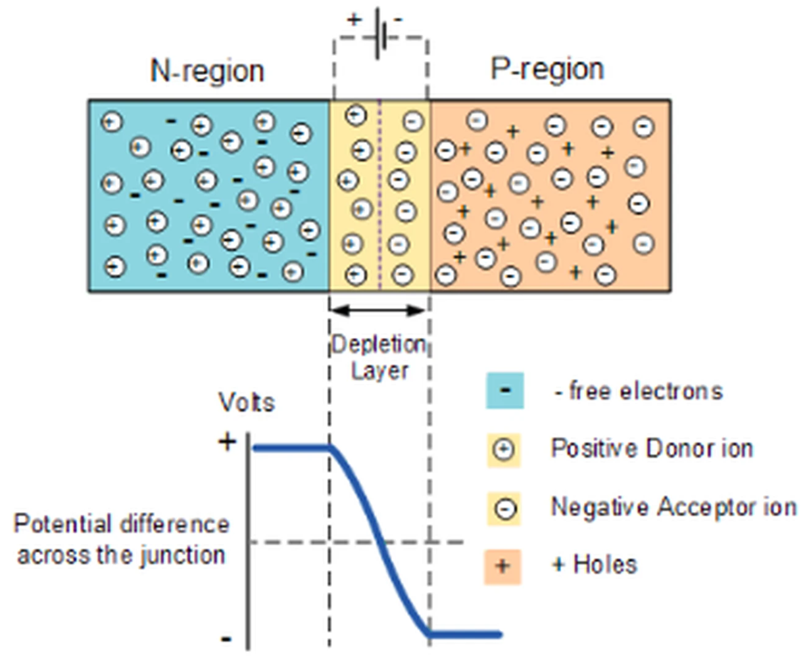
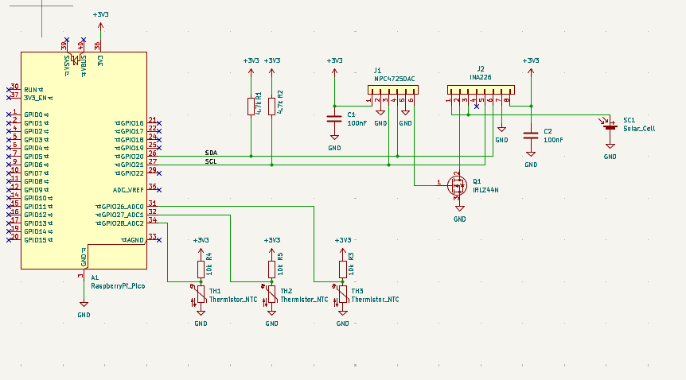

# Efficiëntie en vermogen van zonnecellen

[Aangeleverde PDF openen](Zonnecel.pdf)

## Leerdoelen

- De student kan, aan de hand van een zelfstandig opgesteld meetplan, een experiment uitvoeren met een fotovoltaïsche (PV) cel, waarbij de student de opstelling aansluit en de metingen uitvoert.

- De student kan de stroom-voltage karakteristiek (I-V curve) van zonnecellen uitleggen en bepalen.

- De student kan het maximale vermogen en de fill factor (FF) van een zonnecel bepalen.

- De student kan met een Raspberry Pi Pico, een DAC en een INA226 een meetreeks uitvoeren en de meetgrenzen van de elektronische belasting uitleggen.

!!! veiligheid "Veiligheid"

    1. Schakel de voeding uit voordat je aansluitingen verandert. Controleer de polariteit van de zonnecel en gebruik alleen de door de begeleider vrijgegeven instellingen van de PCB.

    1. De lamp, MOSFET en shunt kunnen warm worden. Houd de lampopstelling vrij en raak warme onderdelen niet aan. Stop de meting bij overschrijding van de afgesproken stroom-, spannings- of vermogensgrenzen.

## Introductie

Zonnecellen vormen een belangrijk toepassingsgebied binnen de technische natuurkunde, waarin halfgeleiderfysica, optica en elektrische netwerkanalyse samenkomen. Een zonnecel, of fotovoltaïsche (PV) cel, zet invallend licht direct om in elektrische energie door middel van het fotovoltaïsche effect. Hierbij komen elektronen vrij wanneer fotonen met voldoende energie het halfgeleidermateriaal raken, meestal silicium. De vrijgekomen ladingsdragers worden vervolgens gescheiden door een intern elektrisch veld, waardoor een meetbare stroom ontstaat.

Zonnecellen spelen een steeds belangrijkere rol in de energietransitie, doordat zij zonlicht direct omzetten in elektrische energie zonder CO#sub[2]-uitstoot. Binnen de technische natuurkunde vormt het begrijpen van de werking, het rendement en het systeemgedrag van zonnecellen een essentieel onderdeel van duurzame technologieontwikkeling. De prestatie van een zonnecel hangt af van factoren zoals de bandkloof, de intensiteit van het licht en interne verliezen, en kan experimenteel worden onderzocht door spanning en stroom te meten bij verschillende belastingen.

!!! voorbereiding "Voorbereidingsopdracht 1"

    1. Bekijk de volgende voorbereidingsfilmpjes ([video 1](https://www.youtube.com/watch?v=xKxrkht7CpY), [video 2](https://www.youtube.com/watch?v=4BX2mEQf09c&t=162s) en [video 3](https://www.youtube.com/watch?v=IkVLQALtdQw)).

    1. Maak een meetplan voor bepalen van het vermogen van een zonnecel. [^1]. Formuleer het hoofddoel/onderzoeksvraag, geef een theoretische verwachting en maak een meetstrategie.

    1. Maak een duidelijke opstelling voor het doormeten van een zonnecel.

    1. Bedenk voor jezelf al wat voor verdiepend onderzoek je wilt doen bij de zonnecel.

## Theorie

Een fotovoltaïsche (PV) zonnecel is in essentie een belichte pn-junction. Een pn-junction wordt gemaakt door één stuk halfgeleidermateriaal aan de ene kant p-type te doteren (met acceptoren) en aan de andere kant n-type (met donoren). In het p-gebied is de ladingsdragerdichtheid van gaten hoog, terwijl in het n-gebied de elektronen domineren. Zodra deze twee regio's met elkaar in contact staan, diffunderen elektronen vanuit het n-gebied naar het p-gebied en diffunderen gaten de andere kant op. Hierdoor blijft in het grensvlak een gedepleteerde (*depletion zone*) laag achter: een gebied waar vrijwel geen vrije ladingsdragers meer aanwezig zijn.

Deze depletion zone bevat wel vaste, geïoniseerde donoren (positief) en acceptoren (negatief), waardoor er een intern elektrisch veld ontstaat dat de diffusie stopt. Dit veld vormt de basis van de pn-overgang. In een zonnecel zorgt juist dit veld ervoor dat nieuw gegenereerde elektronen en gaten, door de absorptie van fotonen, uit elkaar worden getrokken en richting de n- en p-zijde bewegen. Wanneer de externe stroomkring wordt gesloten, kan de cel stroom leveren. Deze fotogegenereerde stroom is dus lichtafhankelijke stroom $I_{\mathrm{ph}}$.

<figure id="fig-pv-schematisch" markdown="1">

{ width="48%" }

<figcaption markdown="1">Figuur 1. Schematische weergave van een zonnecel.</figcaption>

</figure>

Wanneer een externe belasting $R$ wordt aangesloten, ontstaan er een spanning $V$ en stroom $I$ waarvan de waarde afhankelijk is van de gekozen belasting $R$. Door $R$ te variëren kun je de stroomsterkte en spanning variëren en krijg je een volledige I-V-curve. Het maximale elektrische vermogen volgt uit

$$
P = I V \,
$$

 en het punt waarop dit vermogen maximaal is heet het *maximum power point* ($P_{\mathrm{mpp}}$). In commerciële PV-systemen wordt dit punt automatisch gevolgd door de omvormer, die tevens de DC-uitgang omzet naar net-geschikte AC.

De vorm van de I-V-curve wordt gekarakteriseerd met de *fill factor* (FF):

$$
F F = \frac{P_{\mathrm{mpp}}}{V_{\mathrm{oc}} I_{\mathrm{sc}}} \times 100 \% . \tag{1}
$$

 Hierbij zijn $V_{\mathrm{oc}}$ de openklemspanning en $I_{\mathrm{sc}}$ de kortsluitstroom. De FF geeft aan hoe rechthoekig de I-V-curve is. Het rendement vereist daarnaast het optische vermogen dat daadwerkelijk op het actieve celoppervlak valt, $P_{\mathrm{in}}$. Dit is niet het elektrische vermogen van de lamp:

$$
\eta = P_{\mathrm{mpp}} / P_{\mathrm{in}} \times 100 \% . \tag{2}
$$

<figure id="fig-zonnecel-schakeling" markdown="1">

<figcaption markdown="1">Figuur 2. Equivalent elektrisch model van een zonnecel met fotostroombron $I_{\mathrm{ph}}$, diode $I_{D}$, uitgangsstroom $I$ en spanning $V$ over de variabele belasting $R$.</figcaption>

</figure>

Het elektrisch gedrag van een zonnecel wordt doorgaans beschreven met het één-diode-model (Figuur [2](#fig-zonnecel-schakeling)). De fotostroom $I_{\mathrm{ph}}$ werkt als een spanningsonafhankelijke stroombron, terwijl de diode het spanningsafhankelijke recombinatiepad vormt. Uit de knooppuntvergelijking volgt:

$$
I = I_{\mathrm{ph}} - I_{D} . \tag{3}
$$

 De diodestroom wordt beschreven door de wet van Shockley[^2]:

$$
I_{D} = I_{0} (e^{\frac{q V}{n k T}} - 1) \, \tag{4}
$$

 zodat de volledige I-V-relatie van de zonnecel wordt:

$$
I = I_{\mathrm{ph}} - I_{0} (e^{\frac{q V}{n k T}} - 1) . \tag{5}
$$

De twee uiterste punten van de I-V-curve volgen direct uit dit model. Bij $V = 0$ is de diodestroom verwaarloosbaar en geldt:

$$
I_{\mathrm{sc}} = I_{\mathrm{ph}} .
$$

 Bij $I = 0$ verkrijgt men de openklemspanning:

$$
V_{\mathrm{oc}} = \frac{n k T}{q} \ln (I_{\mathrm{ph}} / I_{0} + 1) . \tag{6}
$$

Door de belasting te variëren bemonsteren we de I-V-curve. In dit practicum doet een MOSFET dit elektronisch. Het bereik van de schakeling bepaalt hoe dicht we bij open klem en kortsluiting kunnen meten. Voor het rendement is bovendien een onafhankelijke meting van het invallende optische vermogen nodig.

Het bovenstaande ideale model verwaarloost serie- en lekweerstanden. Hierin zijn $I_{0}$ de verzadigingsstroom, $q$ de elementaire lading, $n$ de idealiteitsfactor, $k$ de constante van Boltzmann en $T$ de absolute temperatuur. Voor een module met $N_{s}$ identieke cellen in serie wordt de noemer in de exponent $n N_{s} k T$; pas de vergelijking dus niet zonder aanpassing op een module toe.

## Elektronische belasting en uitlezing

De opstelling volgt PCB_schema_V1 (Figuur [4](#fig-pcb-overzicht)). De meetmethode blijft hetzelfde: we variëren de belasting van de zonnecel en meten bij ieder werkpunt de spanning en stroom. De *MOSFET Q1 (IRLZ44N) vervult de rol van variabele belastingsweerstand*. Via de computer kunnen we deze belasting automatisch veranderen.

### De onderdelen en hun taak

*Zonnecel — levert elektrische energie.* De lamp belicht de zonnecel. We onderzoeken hoeveel spanning, stroom en vermogen de cel kan leveren.

#### MOSFET Q1 — de elektronisch instelbare belasting

De IRLZ44N is een N-kanaal-MOSFET met drie aansluitingen: gate (G, pin 1), drain (D, pin 2) en source (S, pin 3). De gate is elektrisch geïsoleerd van het stroomvoerende kanaal. Het elektrische veld van de gate beïnvloedt de geleiding tussen drain en source. Hiervoor telt de spanning van de gate *ten opzichte van de source*:

$$
U_{\text{GS}} = U_{\text{G}} - U_{\text{S}} \approx U_{\text{G}} .
$$

In onze schakeling ligt de source aan massa. De DAC-spanning is daardoor ongeveer gelijk aan $U_{\text{GS}}$. Na het opladen van de gatecapaciteit loopt er vrijwel geen stroom de gate in. De stroom van de zonnecel loopt via de drain en source; de DAC levert alleen de stuurspanning.

*Van vrijwel uit naar sterker geleidend.* Bij een kleine $U_{\text{GS}}$ geleidt de MOSFET nauwelijks. De zonnecel is dan vrijwel onbelast: de stroom is klein en de spanning ligt bij de openklemspanning. Boven de drempelspanning $U_{\text{th}}$ ontstaat een geleidend kanaal. Als we de gatespanning verder verhogen, kan de MOSFET meer stroom doorlaten. De belasting neemt toe en het werkpunt schuift langs de I-V-curve naar een grotere stroom en een lagere zonnecelspanning. De drempelspanning is dus niet de spanning waarbij de MOSFET al volledig geleidt.

*Wanneer gedraagt hij zich als een weerstand?* Voor een vaste gatespanning en een kleine drain-sourcespanning is de stroom ongeveer evenredig met $U_{\text{DS}}$. Dit heet het ohmse gebied. Een eenvoudig MOSFET-model geeft daar:

$$
I_{D} \approx \beta ((U_{\text{GS}} - U_{\text{th}}) U_{\text{DS}} - U_{\text{DS}}^{2} / 2) ,
$$

met $U_{\text{GS}} > U_{\text{th}}$ en $0 \le U_{\text{DS}} < U_{\text{GS}} - U_{\text{th}}$. Hierin is $I_{D}$ de drainstroom en $\beta$ een parameter die de sterkte van het kanaal beschrijft, in A/V². Als $U_{\text{DS}}$ veel kleiner is dan $U_{\text{GS}} - U_{\text{th}}$, mogen we de kwadratische term verwaarlozen. Dan volgt:

$$
R_{\text{MOSFET}} = U_{\text{DS}} / I_{D} \approx 1 / (\beta (U_{\text{GS}} - U_{\text{th}})) .
$$

Deze benadering laat zien waarom een hogere gatespanning een kleinere weerstand geeft. Het model verklaart het principe; het is geen nauwkeurige kalibratieformule voor onze vermogens-MOSFET.

*Tijdens de sweep is hij niet overal ohms.* Bij een grotere $U_{\text{DS}}$ kan de MOSFET in het verzadigingsgebied werken. De stroom hangt dan vooral af van de gatespanning en minder sterk van $U_{\text{DS}}$. Hij blijft bruikbaar als regelbare belasting, maar gedraagt zich daar niet als een gewone vaste weerstand. Het werkpunt wordt steeds bepaald door de zonnecel en de MOSFET samen.

*De effectieve belasting uit de meting.* Bij ieder werkpunt met $I > 0$ berekenen we:

$$
R_{\text{eff}} = U_{\text{PV}} / I .
$$

Dit is de weerstand die een gewone belastingsweerstand op dat ene werkpunt zou moeten hebben. Hij omvat de MOSFET, shunt en bedrading. Verwaarlozen we de draadweerstand, dan geldt $U_{\text{PV}} = U_{\text{DS}} + I R_{\text{shunt}}$ en dus $R_{\text{eff}} = U_{\text{DS}} / I + R_{\text{shunt}}$. Deze verhouding is geen constante materiaaleigenschap en ook niet de helling van de I-V-curve.

Bijvoorbeeld: bij $U_{\text{PV}} = 4 \text{V}$ en $I = 0.10 \text{A}$ is de effectieve belasting $40 \text{Ω}$ en het geleverde vermogen $0.40 \text{W}$. Door de DAC-code te veranderen vinden we andere werkpunten. Gelijke stappen in code geven geen gelijke stappen in weerstand. We bepalen de weerstand daarom uit de gemeten spanning en stroom. Zo blijft de analyse met I-V-, P-V- en P-R-curven dezelfde als bij het practicum met een handmatig ingestelde weerstand.

*MCP4725 (DAC) — maakt de stuurspanning.* De DAC zet een getal om in een spanning op de gate van de MOSFET. Zo veranderen we de belasting met de computer.

*INA226 — meet spanning en stroom.* Deze module meet de zonnecelspanning. De stroom bepaalt hij uit de spanning over een kleine meetweerstand op de module: de shunt.

*Raspberry Pi Pico — voert de opdrachten uit.* De Pico stelt de DAC in en leest de INA226 uit. Hij communiceert met beide modules via twee signaaldraden, SDA en SCL. Deze verbinding heet I²C.

*Computer — bestuurt en bewaart.* Het meetprogramma kiest de instellingen, ontvangt de meetwaarden via USB en maakt de grafieken.

*PCB — verbindt de onderdelen.* De printsporen vervangen losse draden. R1 en R2 helpen de I²C-communicatie; de condensatoren houden de modulevoedingen stabiel.

De computer laat dus via de Pico en DAC de MOSFET-belasting variëren, terwijl de INA226 bij iedere instelling spanning en stroom meet.

### Van DAC-code naar werkpunt

De MCP4725 is een 12-bit digitaal-analoogomzetter. Voor code $d$ geldt idealiter:

$$
U_{\text{DAC}} = d / 4096 U_{\text{DD}} , \quad d \in \{ 0 , 1 , \ldots , 4095 \} .
$$

De voedingsspanning is ook de referentiespanning. De DAC wordt volgens het schema gevoed met 3,3 V. Bij deze voeding is één stap ongeveer 0,806 mV; de hoogste code geeft iets minder dan de voedingsspanning. Schrijf tijdens een meetreeks alleen het DAC-register, niet telkens het EEPROM. De DAC kan bij inschakelen een opgeslagen instelling herstellen: controleer de starttoestand voordat de zonnecel wordt aangesloten.

De DAC-code bepaalt dus de gatespanning; de effectieve belasting volgt uit het gemeten werkpunt. Om rechtstreeks een gewenste weerstand in ohm in te stellen, zou de software de code telkens moeten bijregelen op basis van $U_{\text{PV}} / I$. In dit practicum doorlopen we codes en meten we de bijbehorende werkpunten.

### Stroom en spanning meten

De INA226 meet het verschil tussen IN+ en IN− over een shunt, en afzonderlijk de spanning op VBUS ten opzichte van GND:

$$
U_{\text{shunt}} = U_{\text{IN+}} - U_{\text{IN−}} , \quad I = U_{\text{shunt}} / R_{\text{shunt}} .
$$

Gebruik de werkelijke shuntwaarde van de INA226-module. De shunt zit op deze module en is niet een losse weerstand van 4,7 Ω op de basisprint. Voor uitlezing van het stroom- en vermogensregister moet de software de INA226 passend kalibreren. Bij berekening uit de ruwe shuntspanning is de juiste shuntwaarde eveneens noodzakelijk. De busspanning wordt onafhankelijk daarvan gemeten.

Het shuntmeetbereik is ongeveer ±81,92 mV. De shunt moet dus voldoen aan $I_{\text{max}} R_{\text{shunt}} < 81.92 \text{mV}$, met marge. Controleer ook de dissipatie $I^{2} R_{\text{shunt}}$.

<figure id="fig-pcb" markdown="1">

<figcaption markdown="1">Figuur 3. Schakeling voor het meten van de stroom-spanningskarakteristiek van een zonnepaneel. De Raspberry Pi Pico regelt via de MCP4725-DAC en MOSFET de belasting, terwijl de INA226 de stroomsterkte en spanning meet. Pull-upweerstanden zorgen voor een betrouwbare I²C-communicatie en ontkoppelcondensatoren stabiliseren de voedingsspanning.</figcaption>

</figure>

Het vermogenspad loopt van SC1 (PV+) via de shunt op de INA226-module naar de drain van Q1 (pin 2). De source (pin 3) en PV− zijn verbonden met GND. Bij een INA226-module waarvan VBUS met IN+ aan PV+ is verbonden geldt $U_{\text{GS}} \approx U_{\text{DAC}}$, $U_{\text{PV}} = U_{\text{BUS}}$ en $P_{\text{PV}} = U_{\text{PV}} I$. Er hoeft dan geen shuntspanning bij de busspanning te worden opgeteld. Het nieuwe schema tekent de module als connector J2, zonder interne schakeling: controleer deze VBUS-verbinding op de gebruikte module.

De DAC-uitgang op J1 is rechtstreeks met de gate van Q1 verbonden. Er is geen opamp of afzonderlijke stroomregelkring getekend. De DAC-code stelt dus de gate aan; de gemeten stroom is het resultaat van de zonnecel en de belasting samen.

### Aansluitingen en voeding

De Pico voedt de modules via 3V3 (pin 36). Alle GND-aansluitingen delen dezelfde massa. C1 en C2 zijn ontkoppelcondensatoren van elk 100 nF. De I²C-bus gebruikt GPIO20 voor SDA (pin 26) en GPIO21 voor SCL (pin 27). R1 en R2 zijn pull-upweerstanden van 4,7 kΩ naar 3,3 V; het zijn geen belastingsweerstanden. Configureer deze GPIO's in de meetsoftware en controleer de I²C-adressen van beide modules.

*Schemacontrole:* vergelijk de bestukte print met PCB_schema_V1. Controleer het gemonteerde MOSFET-type, de shuntwaarde en de pinfuncties van J1 en J2. Meet spanningsloos de verbindingen na, waaronder source, PV− en GND. De connectornaam “MPC4725DAC” in de afbeelding bedoelt de *MCP4725*.

De meetgrens van 36 V van de INA226 is geen grens voor de volledige PCB: die hangt af van alle onderdelen. Gebruik uitsluitend de vrijgegeven meetgrenzen van de opstelling.

### Meetbereik en meetvolgorde

Bij een uitgeschakelde MOSFET meet je bij benadering open klem. Bij maximale geleiding blijven de weerstand van de MOSFET, shunt en bedrading aanwezig: een hoge DAC-code garandeert geen echte kortsluiting. De gate wordt hier tot maximaal ongeveer 3,3 V aangestuurd. Voor de IRLZ44N is de lage aan-weerstand in de datasheet gespecificeerd bij hogere gatespanningen (vanaf 4 V); volledige geleiding bij 3,3 V is dus niet gegarandeerd. De drempelspanning betekent alleen dat de transistor begint te geleiden. Beoordeel dit aan de gemeten spanning, niet alleen aan de code.

De MOSFET dissipeert $P_{\text{MOSFET}} = U_{\text{DS}} I$. Controleer voor de gekozen MOSFET de toelaatbare combinatie van spanning en stroom bij continue belasting (DC safe operating area) en de koeling. Alleen het maximale nominale vermogen controleren is onvoldoende.

De meetsoftware voert steeds dezelfde cyclus uit: stel de DAC-code in, laat het werkpunt stabiliseren, wacht op een volledige nieuwe INA226-meting en sla de waarden op. Houd rekening met conversietijden en ingestelde middeling; direct uitlezen kan nog een oude waarde opleveren. Zet de DAC na afloop en bij een afgebroken meting terug naar nul.

<figure id="fig-pcb-overzicht" markdown="1">

<figcaption markdown="1">Figuur 4. PCB_schema_V1: Raspberry Pi Pico, DAC op J1, INA226-module op J2, IRLZ44N-belasting. De overige meetkanalen worden hier niet gebruikt. De interne schakelingen van de modules zijn niet getekend.</figcaption>

</figure>

## Practicum

!!! opdracht "Opdracht 1 — Opstelling en controle"

    1. Noteer het MOSFET-type, de shuntwaarde, DAC-voeding, I²C-adressen en de door de begeleider opgegeven meetgrenzen. Vergelijk de aansluitingen met het schema: VBUS en IN+ aan PV+, IN− aan drain en source aan GND/PV−. Laat afwijkingen eerst door de begeleider controleren.
    1. Begin met DAC-code nul en controleer spanning en stroom. Vergelijk de spanning met een multimeter. Test vervolgens enkele kleine stappen en controleer de stroomrichting en de reactie van het werkpunt.
    1. Richt de lamp zo dat de cel zo homogeen mogelijk wordt belicht. Noteer afstand, hoek en actief oppervlak. Houd deze omstandigheden tijdens een meetreeks constant en laat de lamp eerst stabiliseren.
    1. Meet, indien geschikte apparatuur beschikbaar is, de instraling in het midden en bij de randen. Een luxmeting alleen is geen meting van optisch vermogen in W/m².

!!! opdracht "Opdracht 2 — Een automatische meetreeks"

    1. Maak een eerste sweep vanaf code nul binnen de vrijgegeven grenzen. Bewaar per punt de tijd, DAC-code, busspanning, shuntspanning, berekende stroom en zonnecelspanning. Noteer ook de conversietijd, middeling en wachttijd.
    1. Bekijk de I-V-curve tijdens een proefmeting. Verzamel minimaal 20 bruikbare, verschillende werkpunten en voeg extra punten toe rond de knik en het vermogensmaximum. Veel codes kunnen vrijwel hetzelfde werkpunt geven.
    1. Herhaal de sweep in omgekeerde richting. Onderzoek verschillen door opwarming, veranderende belichting of onvoldoende wachttijd. Bewaar herhalingen voor de onzekerheidsanalyse.
    1. Controleer hoe dicht je werkelijk bij $I = 0$ en $U_{\text{PV}} = 0$ komt. Leg vast welk deel van de curve buiten het meetbereik blijft. Zet de DAC na afloop op nul.

!!! opdracht "Opdracht 3 — Analyse"

    1. Plot de I-V-curve met eenheden en meetonzekerheden. Bepaal de openklemspanning en kortsluitstroom uit metingen nabij de eindpunten. Gebruik een lokale extrapolatie alleen als de meetpunten dit ondersteunen; vermeld de methode en onzekerheid. Noem een niet bereikbaar eindpunt geen directe meting.
    1. Bereken per meetpunt $P = U_{\text{PV}} I$ en maak de P-V-curve. Bepaal $P_{\text{mpp}}$, $U_{\text{mpp}}$ en $I_{\text{mpp}}$. Verfijn de sweep rond het maximum en bespreek de invloed van de stapgrootte.
    1. Bereken de fill factor als beide eindpunten voldoende betrouwbaar bekend zijn. Bespreek de invloed van shuntkalibratie, herhaalbaarheid en eventuele extrapolatie. De fill factor is niet het rendement.
    1. Bepaal alleen bij een gekalibreerde instralingsmeting het rendement. Bij homogene instraling $E$ in W/m² en actief oppervlak $A$ geldt $P_{\text{in}} = E A$. Zonder die meting rapporteer je dat het rendement niet bepaald kan worden.
    1. Bereken $R_{\text{eff}} = U_{\text{PV}} / I$ voor punten met voldoende grote stroom. Plot deze effectieve belasting tegen de DAC-code en maak een P-R-curve. Leg uit hoe de computer de variabele belasting instelt en waarom gelijke stappen in DAC-code geen gelijke stappen in weerstand geven. Bereken bij open klem geen weerstand door te delen door een stroom die binnen de meetonzekerheid nul is.

!!! opdracht "Opdracht 4 — Verdiepend onderzoek"

    1. Schrijf een kort meetplan van maximaal tien regels voor de invloed van bijvoorbeeld invalshoek, afstand of gedeeltelijke beschaduwing. Kies één variabele en benoem welke omstandigheden je constant houdt.
    1. Voer het onderzoek uit met herhaalde I-V- en P-V-metingen. Vergelijk de maxima en, waar betrouwbaar bepaalbaar, de eindpunten en fill factors. Onderbouw de conclusie met onzekerheden.

!!! afronding "Afronding"

    1. Zet de gevonden figuren in je digitaal labjournaal en maak een duidelijk onderschrift waarin je uitlegt wat de figuren laten zien.

    1. Vul de **Resultaat- en Discussie**-sectie aan in je labjournaal. Hierin moet de uiteindelijke waarde van jouw experiment (met onzekerheid) staan en een korte discussie of deze waarde **realistisch** en **betrouwbaar** is.

## Bijlage A — Pinverbindingen

De nummers bij J1 en J2 zijn connectorpinnen uit PCB_schema_V1, niet de pinnummers van de losse IC’s. Controleer bij een andere module de opschriften en pinvolgorde. De Pico-kolom noemt de fysieke headerpin en waar nodig het GPIO-nummer.

| *Van / aansluiting* | *Naar / aansluiting* | *Functie* |
| --- | --- | --- |
| Pico pin 36 (3V3) | J1-1 (VDD), J2-8 (VCC) | Voeding van beide modules: 3,3 V. |
| Pico GND (bijv. pin 38) | J1-2, J1-5, J2-7, Q1-3 en PV− | Gemeenschappelijke massa; J1-5 is A0. |
| Pico pin 26 (GPIO20) | J1-4 (SDA), J2-6 (SDA) | I²C-data; GPIO20 is niet fysieke pin 20. |
| Pico pin 27 (GPIO21) | J1-3 (SCL), J2-5 (SCL) | I²C-klok. |
| J1-6 (DAC OUT) | Q1 pin 1 (gate) | Analoge stuurspanning voor de belasting. |
| PV+ (zonnecel) | J2-1 (IN+) en J2-3 (VBS) | Positieve stroomingang en busspanningsmeting. |
| J2-2 (IN−) | Q1 pin 2 (drain) | Stroompad na de shunt op de module. |
| Q1 pin 3 (source) | GND / PV− | Retour van de belastingsstroom. |
| J2-4 (ALE / ALERT) | Niet aangesloten | Alarmuitgang niet gebruikt. |
| R1 (4,7 kΩ) | Tussen 3V3 en SDA | Pull-up voor de datalijn. |
| R2 (4,7 kΩ) | Tussen 3V3 en SCL | Pull-up voor de kloklijn. |
| C1 (100 nF) | Tussen J1-1 (VDD) en GND | Ontkoppeling van de DAC-voeding. |
| C2 (100 nF) | Tussen J2-8 (VCC) en GND | Ontkoppeling van de INA226-voeding. |
| Computer USB | USB-aansluiting Pico | Voeding en uitwisseling van opdrachten en meetwaarden. |

VBS is de moduleaansluiting voor VBUS. De tabel volgt de verbinding met IN+ aan PV+. Controleer deze verbinding op de gebruikte module; alleen dan geldt zonnecelspanning = gemeten busspanning. Bij Q1 gelden gate = 1, drain = 2 en source = 3; controleer de montagerichting met de datasheet.

## Bijlage B — Materialenlijst

Benodigdheden per meetopstelling. Bij een reeds bestukte PCB zijn de Pico, modules en losse printonderdelen inbegrepen; deze worden niet dubbel uitgedeeld. Gebruik de door de begeleider vrijgegeven stroom- en vermogensgrenzen.

| *Aantal* | *Materiaal* | *Toepassing* |
| --- | --- | --- |
| 1 | Zonnecel of zonnecelmodule | Met aansluitdraden naar PV+ en PV−. |
| 1 | Lamp met voeding en houder | Voor een vaste, zo homogeen mogelijke belichting. |
| 1 | Zonnecel-PCB volgens PCB_schema_V1 | Bestukte print met de hieronder genoemde onderdelen. |
| 1 | Raspberry Pi Pico | Met passende headers en meetfirmware. |
| 1 | MCP4725 DAC-module | 12-bit DAC op connector J1. |
| 1 | INA226-meetmodule met shunt | Op J2; noteer de werkelijke shuntwaarde voor de kalibratie. |
| 1 | IRLZ44N MOSFET (Q1) | Met koeling passend bij de vrijgegeven dissipatie. |
| 2 | Weerstand 4,7 kΩ | R1 en R2: I²C-pull-ups. |
| 2 | Condensator 100 nF | C1 en C2: voedingsontkoppeling. |
| 1 set | Headers, aansluitklemmen en bedrading | Voor de modules en de zonnecelaansluiting. |
| 1 | Computer met meet- en analysesoftware | Voor instellen, opslaan en verwerken van de meetreeks. |
| 1 | USB-datakabel voor de Pico | Een kabel die ook data overdraagt. |
| 1 | Multimeter | Voor controle van verbindingen en spanning. |
| 1 set | Houders en liniaal of meetlint | Voor vaste afstand en stand van lamp en zonnecel. |
| Optioneel | Gekalibreerde instralingsmeter | Nodig voor rendement uit instraling in W/m² en celoppervlak. |

## Bijlage C — Versimpelde schakelingen

<figure id="fig-pcb-3" markdown="1">

<figcaption markdown="1">Figuur 5. De variabele weerstand dient als instelbare belasting van het zonnepaneel, onafhankelijk van de Raspberry Pi Pico. De INA226 bepaalt de stroomsterkte via het spanningsverschil over de shuntweerstand ($\Delta U = U_{\text{IN+}} - U_{\text{IN-}}$). Via VBUS wordt de spanning ten opzichte van GND gemeten.</figcaption>

</figure>

<figure id="fig-pcb-2" markdown="1">

<figcaption markdown="1">Figuur 6. Zonnecelschakeling waarbij een MOSFET als elektronisch regelbare belasting fungeert. De Raspberry Pi Pico stuurt via de MCP4725-DAC de gatespanning van de MOSFET aan. Er worden geen stroom- of spanningsmetingen uitgevoerd. De MOSFET fungeert als elektronisch regelbare belasting van het zonnepaneel. Door de gatespanning met de DAC te variëren, verandert de geleiding van de MOSFET en daarmee de stroom die het zonnepaneel levert.</figcaption>

</figure>

<figure id="fig-pcb-4" markdown="1">

<figcaption markdown="1">Figuur 7. Schakeling voor het meten van de stroom-spanningskarakteristiek van een zonnepaneel. De Raspberry Pi Pico regelt via de MCP4725-DAC en MOSFET de belasting, terwijl de INA226 de bijbehorende stroomsterkte en spanning meet.</figcaption>

</figure>

## Componentdocumentatie

- [Microchip MCP4725](https://www.microchip.com/en-us/product/mcp4725): DAC-overdracht, voeding, I²C en opstartgedrag.
- [Texas Instruments INA226-datasheet](https://www.ti.com/lit/ds/symlink/ina226.pdf): shunt- en busmeting, kalibratie en conversietijden.

- [Infineon IRLZ44N-datasheet](https://www.infineon.com/assets/row/public/documents/24/49/infineon-irlz44n-datasheet-en.pdf): pinfuncties, gate-aansturing en toelaatbare dissipatie.

- [Infineon: werking van MOSFETs](https://www.infineon.com/technology/mosfets): gatebesturing en werkgebieden.
- [Nexperia: MOSFETs als elektronische belasting](https://www.nexperia.com/applications/interactive-app-notes/IAN50006_Power_MOSFETs_in_linear_mode): verzadigingsgebied en dissipatie.

[^1]: Zie Brightspace voor een korte uitleg over een meetplan.

[^2]: De benaming “de wet van Shockley'' verdient enige nuance. Hoewel William Shockley een belangrijke bijdrage leverde aan de halfgeleiderfysica, is hij later bekend geworden om zijn controversiële en onwetenschappelijke uitspraken over intelligentie en ras. Deze opvattingen staan haaks op de waarden van de academische gemeenschap. Om die reden kiezen sommige instellingen ervoor om de betreffende diodevergelijking neutraal te benoemen, bijvoorbeeld als de ideale diodevergelijking of de pn-overgangsvergelijking.
